<div align="center">


<br>

[](LICENSE)
[](https://vigia-web.vigiaperu.workers.dev)
[](#built-with)
[](#observability-with-arize)


**[Live site](https://vigia-web.vigiaperu.workers.dev)** &nbsp;|&nbsp;
**[How it works](#how-it-works)** &nbsp;|&nbsp;
**[Architecture](#architecture)** &nbsp;|&nbsp;
**[Data](#data)** &nbsp;|&nbsp;
**[Run it locally](#run-it-locally)**

</div>

---

> **Corruption in Peru is already public. Vigía makes it _readable_.**
> Every tender, contract and debarred company is open data. The bottleneck was never the data, it was the
> **cost of reading it**. Vigía funds that reading with small donations: a contract is read for **S/ 3**, and the
> result is public, always.

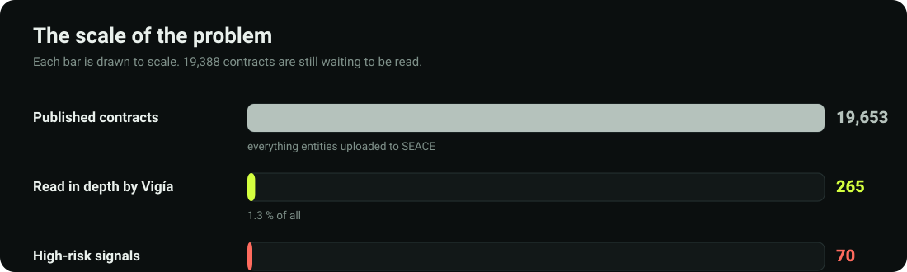

## Why it exists

Investigating **one** suspicious state contract takes a journalist days: 80-page scanned PDFs spread over a dozen
`.gob.pe` portals that do not talk to each other. Peru has published about **20 thousand contracts in 2026 alone**. Oversight is a
slow, heroic act that does not scale. Vigía puts AI agents to read the bidding file, cross it with official records and
point at the contracts that deserve a second look, each signal **linked to the law it cites and the document it comes from**.

> [!IMPORTANT]
> **We never accuse anyone.** A signal is a reason to review a contract, never a charge: not against a company, a person
> or a party. No verifiable link to an official source means it is not published.

---

## What you can do

<table>
<tr>
<td width="25%" valign="top">

### 🗺️ Citizens
One map, three readings: **who governs** your region, **how much is contracted** there, and **how much Vigía has read**.

</td>
<td width="25%" valign="top">

### 🔎 Investigators
Signals with the **law and the evidence**, searchable by contract, entity, RUC or region. A read-only **MCP server** brings it to any AI assistant.

</td>
<td width="25%" valign="top">

### 🤝 Donors
Fund the reading **by zone, by entity or by party and electoral term**. Nobody picks which contracts are read.

</td>
<td width="25%" valign="top">

### 📸 Neighbours
Report a stalled work with a photo and a place. Two independent reports in 30 days confirm it.

</td>
</tr>
</table>

<div align="center">
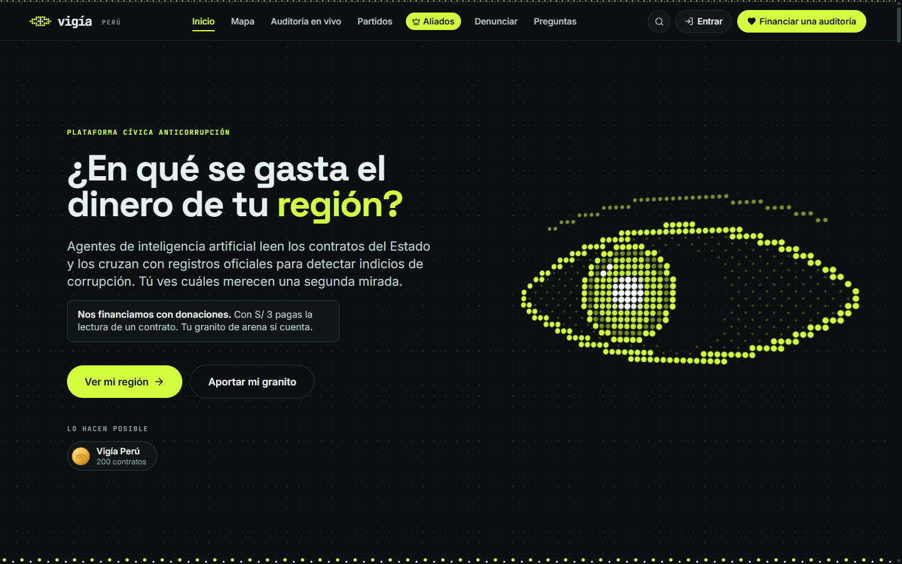
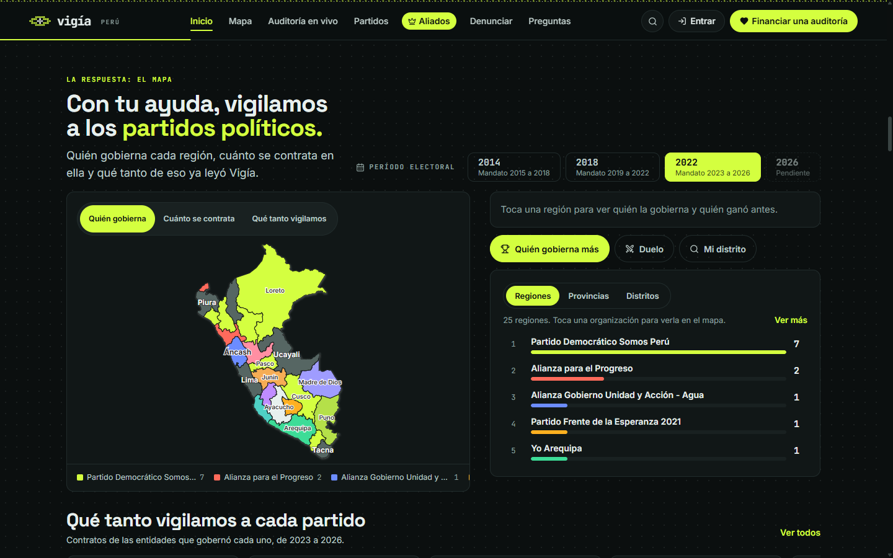
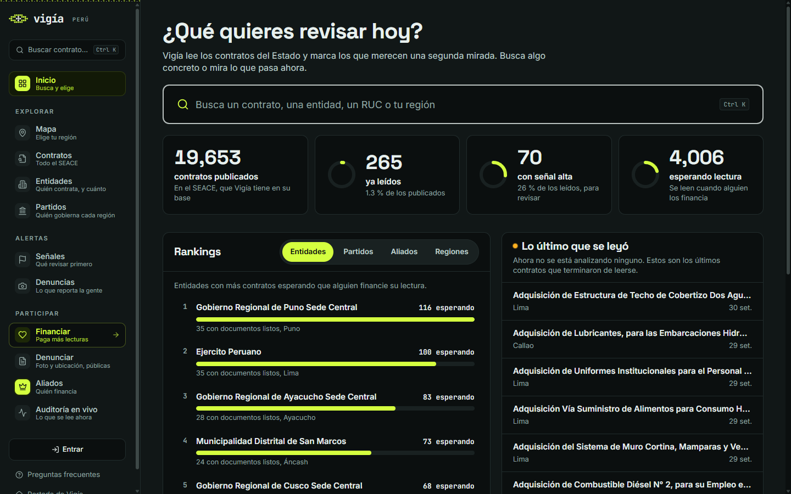
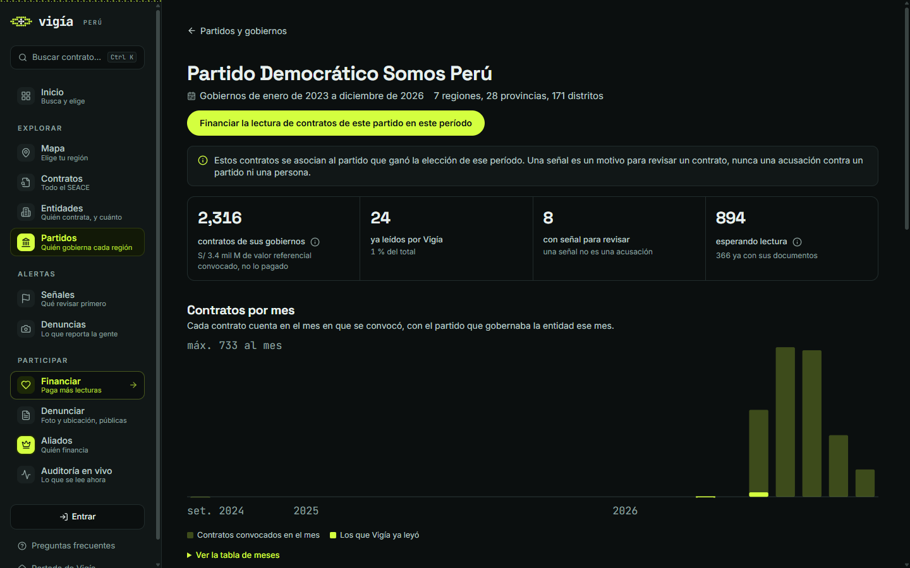
</div>

---

## How it works

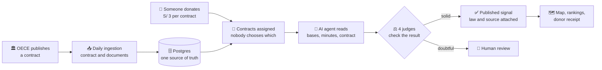

Each reading ends with four self-evaluation judges (flag support, evidence citation, non-accusatory tone, pipeline
completeness). A doubtful result goes to a person instead of being published, and a published result stays public even
if it points at the donor who paid for it.

### Contracts by political party

Every contract is linked to the party that governed the contracting entity **in the month the contract was called**,
using the regional and municipal election results of 2014, 2018 and 2022 (JNE). A donor can fund the reading of the
contracts of one party in one electoral term, and the contracts are picked at random among those entities.

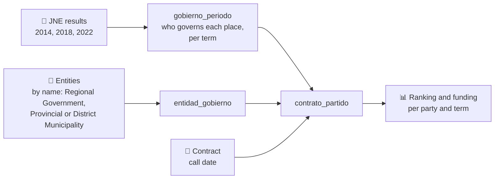

> [!NOTE]
> The link is made with the **election winner**. Vacancies, recalls and replacements inside a term are not recorded, and
> the interface says so. Only entities that are a regional government or a municipality have a party. Ministries and
> agencies do not. See [`41_aporte_por_partido.sql`](backend/db/migrations/41_aporte_por_partido.sql).

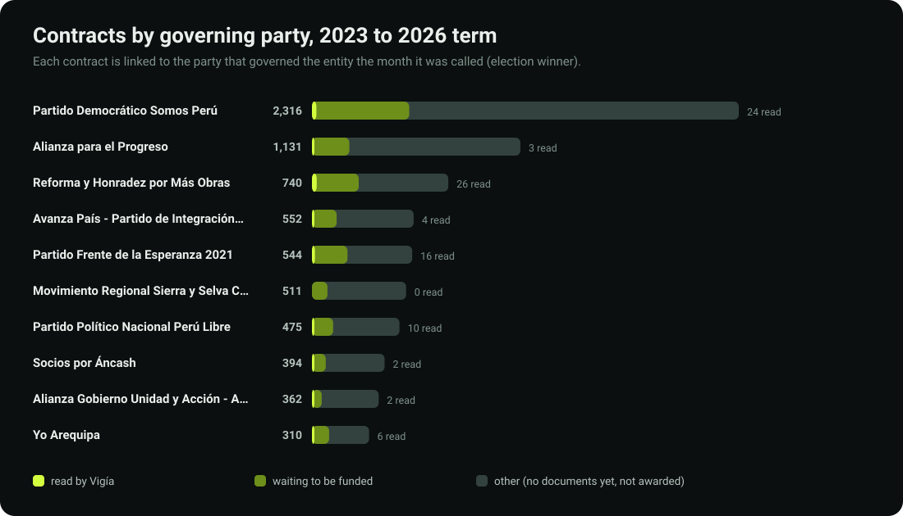

---

## Architecture

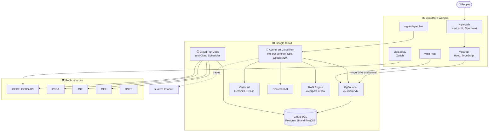

| Layer | What it does | Where it runs |
|---|---|---|
| **Web and API** | The site, the read and write API, the dispatcher and the MCP server | Cloudflare Workers |
| **Database** | One Postgres is the source of truth. Roles per component, read models and the contract assignment functions live inside it | Cloud SQL, behind PgBouncer |
| **Agents** | One service per contract type (goods, services, works, other). The order of the agents is **code**, not a model's decision | Cloud Run |
| **Ingestion** | Contracts every day at 06:00 Lima, documents at 02:00, plus weekly and monthly scrapers | Cloud Run Jobs and Scheduler |
| **Relay** | The OECE API only answers to nearby IPs, so a Worker in Zurich relays it | Cloudflare Worker |

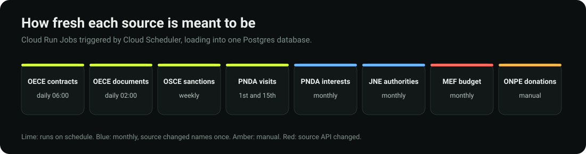

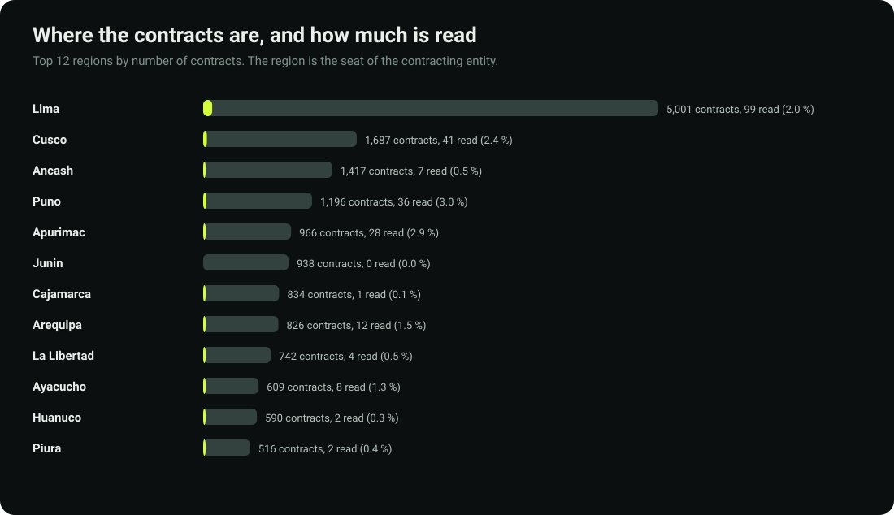

---

## Data

The raw datasets are **not** in this repository: they are large and some contain personal data (the RNP registry has
partners' names and IDs). We link the official open-data sources instead. Details in [`docs/DATA.md`](docs/DATA.md).

| Source | Used for | Cadence |
|---|---|---|
| **OECE, Contrataciones Abiertas (OCDS)** | Contracts, entities, amounts, stage | 🟢 daily |
| **OECE documents** | Bidding files and contracts in PDF | 🟢 daily |
| **PNDA** (datosabiertos.gob.pe) | Sanctions, entity visits, penalties, interest declarations | 🟢 weekly to monthly |
| **JNE, Infogob** | Authorities, candidacies, who governs each place | 🟡 monthly and per election |
| **MEF** | Regional budget | 🔴 monthly, the source changed its API |
| **ONPE, Claridad** | Campaign contributions | 🟠 manual, it needs a browser and a Peruvian IP |
| **SUNAT** (via decolecta) | Company age and status | ⚪ on demand |

> [!WARNING]
> Personal data is never shown in clear. IDs and surnames sit behind frosted glass until clicked. Companies and public
> officials are not censored.

<details>
<summary><b>The alert engine</b>, rule by rule</summary>

<br>

| Rule | What it looks for |
|---|---|
| Sanctioned supplier | A winner with a current OSCE sanction |
| Single bidder | One valid offer at 100 % of the reference value |
| Direct award | Direct hiring without valid grounds |
| Addenda | Changes above 25 % of the original amount |
| New company | A company created shortly before winning |
| Penalties | Suppliers with a history of penalties |
| Revolving door | An official whose declared past jobs include the supplier |
| Campaign money | Contributions to a campaign followed by contracts from the same government |

Each flag cites its legal basis and the official document it comes from. Model-assisted legal and market analysis sits
on top of the rules.

</details>

---

## MCP server

<table>
<tr>
<td width="60%">

`backend/mcp` is a remote [Model Context Protocol](https://modelcontextprotocol.io) server with **read-only** tools.
A journalist can ask their own AI assistant *"show me the high-risk contracts in Áncash"* and get them back **with their
official evidence attached**, without scraping and without the interface. It only exposes public data and never writes
to the database.

</td>
<td width="40%">

```text
> show me the high-risk
  contracts in Áncash

each result carries:
  the law it cites
  the official document
  the state of the reading
```

</td>
</tr>
</table>

---

## Built with

<table>
<tr><th>Area</th><th>Technology</th></tr>
<tr><td>🌐 Web</td><td>Next.js 14, React, Tailwind, GSAP, d3-geo. Identity: charcoal and lime, a dot-matrix eye</td></tr>
<tr><td>⚙️ API</td><td>Hono (TypeScript) on Cloudflare Workers and Cloud Run</td></tr>
<tr><td>🤖 Agents</td><td>Python, Google ADK, Gemini on Vertex AI (<code>3.6 flash</code> for analysis, <code>3.5 flash-lite</code> for fast steps and judges), Flex pricing</td></tr>
<tr><td>📄 Documents and law</td><td>Document AI for PDF text, RAG Engine with 4 corpora (current and historical law, criteria, control)</td></tr>
<tr><td>🗄️ Data</td><td>PostgreSQL 16 with PostGIS, PgBouncer, Hyperdrive</td></tr>
<tr><td>📥 Ingestion</td><td>Python scrapers as Cloud Run Jobs, Cloud Scheduler</td></tr>
<tr><td>📊 Observability</td><td>OpenInference, OpenTelemetry, Arize Phoenix</td></tr>
<tr><td>🏗️ Infrastructure</td><td>Terraform and one deploy script per component</td></tr>
</table>

A reading costs about **US$ 0.17** after the Flex pricing and caching work, against a S/ 3 donation per contract.

### Observability with Arize

OpenInference instruments the ADK runner and every Gemini call and exports to **Arize Phoenix**: a full span tree
per contract with tokens, cost, latency, prompts and responses. If an agent drifts, it shows up in the trace.

<div align="center">


</div>

---

## Repository

```text
vigia-peru/
├── frontend/                 Next.js 14: portada, /app (map, contracts, signals, entities, parties, funding), /admin
├── backend/
│   ├── agent/                ADK agents in Python, one per contract type, deterministic pipeline
│   ├── api/                  Read and write API (Hono) for Cloudflare Workers and Cloud Run
│   ├── dispatcher-worker/    Hands paid contracts to the agents
│   ├── mcp/ and mcp-worker/  Read-only MCP server
│   ├── relay-worker/         Zurich relay to the OECE API
│   ├── r2-sync-worker/       GCS to R2 file copy
│   ├── db/migrations/        Numbered SQL migrations (01 to 41) and apply_all.py
│   ├── scrapers/             Ingestion pipelines: PNDA, OCDS, MEF, ONPE, JNE
│   └── scripts/              Loaders and generators (who governs each place, README charts)
├── infrastructure/
│   ├── terraform/            The platform as code
│   └── deploy/               One script per component, and the project-move runbook
└── docs/                     DATA.md, DATASET_MAP.md, MARCO_NORMATIVO.md, images
```

## Run it locally

Each component ships a `.env.example`.

```bash
# Database: Postgres 16 with PostGIS
docker compose -f infrastructure/docker-compose.yml up -d
python backend/db/apply_all.py              # PGHOST=127.0.0.1 PGPASSWORD=vigia by default

# API
cd backend/api && npm install && cp .env.example .env && npm run dev
npm test                                     # unit tests

# Web
cd frontend && npm install && cp .env.example .env.local && npm run dev

# Scrapers
cd backend && pip install -r scrapers/requirements.txt && python -m pytest scrapers/tests

# Regenerate the charts in this README from the live API
python backend/scripts/generar_graficos_readme.py
```

> [!TIP]
> Deploys go one component at a time, in this order: **migration, then API, then web**
> (`infrastructure/deploy/*.sh`). Credentials live in environment variables or Secret Manager, never in the repo.

## Principles

1. **We never accuse anyone.** A signal is a reason to review, never a charge.
2. **We never publish citizens' personal data.** Only serving officials and companies that contract with the State.
3. **We do not replace the Comptroller, the prosecutors or journalism.** We detect and prioritize.
4. **Citizen reports:** two independent reports within 30 days to be confirmed. No photo, not published.
5. **Funding buys reading, not results:** donors do not choose contracts, cannot edit findings, and are published even if flagged.
6. **Every flag links to official evidence.** No verifiable link, not published.
7. **No ads, no data monetization.** Open source and non-profit.

## Status

A working platform with national coverage of published contracts (about 20 thousand in the base), the three-reading map,
funding by zone, entity and party, public donor profiles and an admin panel. Reading with AI is funded by donations, so the
share of contracts read grows as people contribute.

**Known gaps:** ONPE contributions are loaded by hand, payments are validated manually (there is no gateway yet), and the
2026 election results will be added when the JNE proclaims them.

Spanish documents: [`ARQUITECTURA.md`](ARQUITECTURA.md), [`SOLUCION.md`](SOLUCION.md), [`OBSERVABILITY.md`](OBSERVABILITY.md).

---

<div align="center">

**MIT License.** Open source, non-profit, no ads, no data monetization.

*Built for Peru* 🇵🇪

</div>
