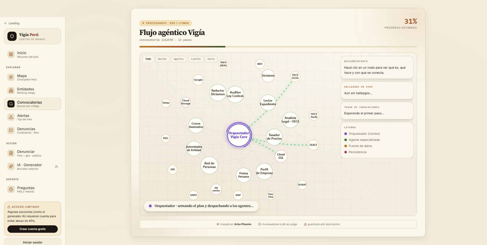
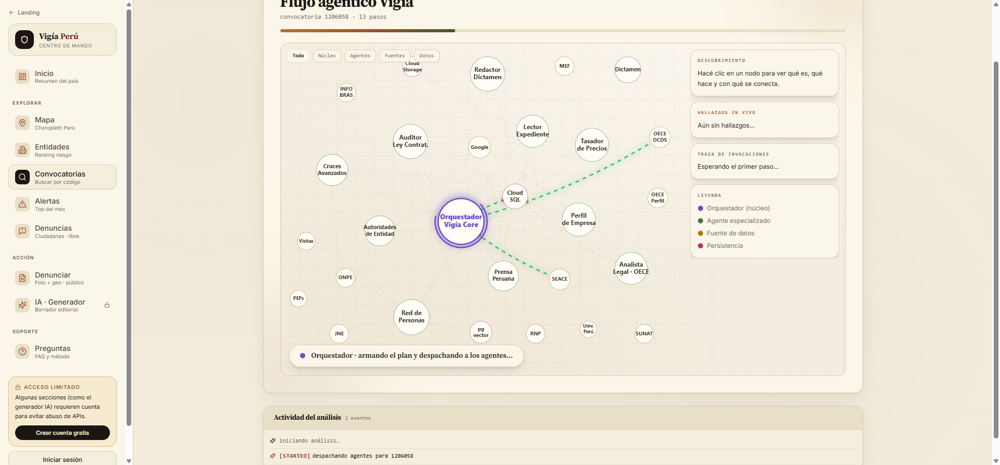
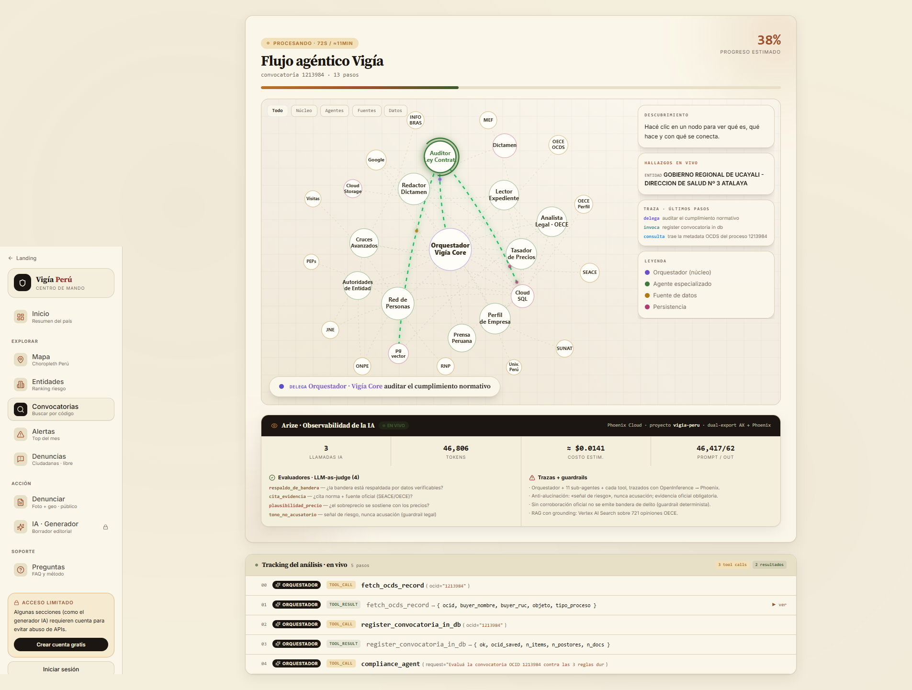
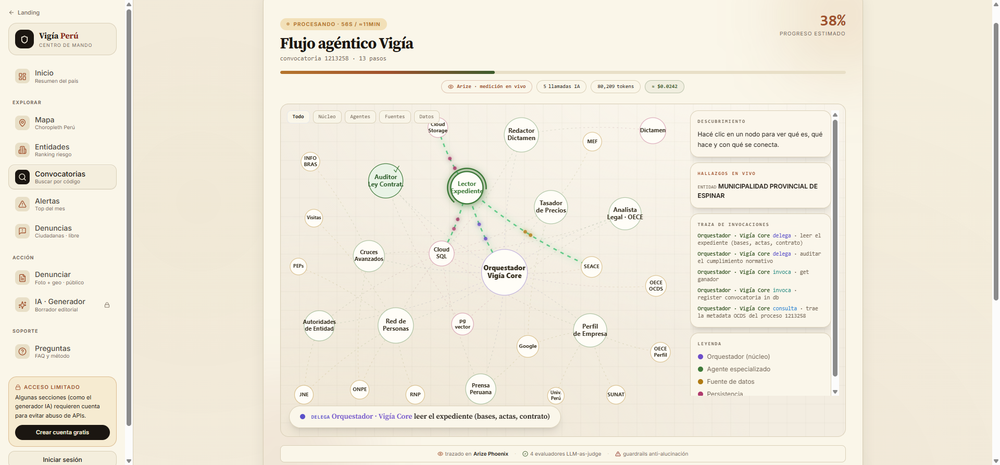

# vigía_ Perú

### Civic anti-corruption platform. AI agents read Peru's public contracts, cross them with official records, and flag the ones that deserve a second look.

> **Corruption in Peru is already public. Vigía makes it _readable_.**
> Every tender, contract and debarred company is open data. The bottleneck was never the data,
> it was the **cost of reading it**. Vigía funds that reading with small donations: a contract is read
> for **S/ 3**, and the result is public, always.

**Live:** https://vigia-web.vigiaperu.workers.dev  ·  **Observability:** Arize Phoenix, project `vigia-peru`
**Spanish docs:** [`ARQUITECTURA.md`](ARQUITECTURA.md) · [`SOLUCION.md`](SOLUCION.md) · [`OBSERVABILITY.md`](OBSERVABILITY.md)



---

## What it does

| For | What you get |
|---|---|
| **Any citizen** | Pick your region on one map and see three readings: **who governs it**, **how much money is contracted**, and **how much of it Vigía has already read**. Every contract has a plain-language status. |
| **Journalists and investigators** | Risk signals with the **law they cite** and the **official document** they come from, ready to verify and quote. Search by contract, entity, RUC or region. A read-only **MCP server** exposes the same evidence to any AI assistant. |
| **Donors** | Fund the reading of contracts **by zone, by entity or by political party and electoral period**. Nobody picks which contracts are read, results are published even if they point at the donor, and the ranking counts contracts, never soles. |
| **Neighbours** | Report a stalled or suspicious public work with a photo and a location. Two independent reports within 30 days confirm it. |

> **Non-negotiable principle:** we never accuse anyone. A signal is a reason to review a contract,
> never a charge. No verifiable link to an official source means it is not published.

### Contracts by political party

Every contract is linked to the party that governed the contracting entity **in the month the contract was
called**, using the regional and municipal election results (JNE, 2014, 2018 and 2022 terms). The link is made
with the election winner: vacancies, recalls and replacements inside a term are not recorded, and the UI says so.
Funding by party picks contracts at random among those of the entities that party governed in a given term.
See [`backend/db/migrations/41_aporte_por_partido.sql`](backend/db/migrations/41_aporte_por_partido.sql).

---

## Architecture at a glance

```
 People ─► Cloudflare Workers ──────────────────────────────────────────────┐
           vigia-web (Next.js 14, OpenNext)                                   │
           vigia-api (Hono / TypeScript)  ─ Hyperdrive ─► tunnel ─► PgBouncer ─► Cloud SQL (Postgres 16 + PostGIS)
           vigia-dispatcher · vigia-mcp · vigia-relay · vigia-r2-sync          │
                       │                                                      │
                       ▼                                                      │
   Cloud Run agents (one per contract type, Google ADK) ◄── reads / writes ───┘
     ├─ Vertex AI · Gemini 3.6 Flash (+ Flash-Lite judges)
     ├─ Document AI (PDF text)
     └─ RAG Engine · 4 corpora of procurement law and OECE opinions

   Cloud Run Jobs + Cloud Scheduler ─► OECE (OCDS), PNDA, JNE, MEF, ONPE ─► GCS ─► Postgres
```

* **Edge:** the public site, the API, the dispatcher and the MCP server run on **Cloudflare Workers**.
  A Worker in Zurich relays the OECE API, which only answers to Peruvian and nearby IPs.
* **Core:** one Postgres database is the source of truth. Roles per component, read models, and the contract
  assignment functions live inside the database.
* **AI:** each contract type (goods, services, works, other) has its own Cloud Run agent. The sequence of
  agents is **deterministic code**, not a model's decision, and each reading ends with four self-evaluation
  judges before anything is published.
* **Data:** daily ingestion of new contracts (06:00 Lima) and their documents (02:00), plus monthly and weekly
  scrapers for sanctions, visits, interest declarations, authorities and budget.



---

## MCP server: Vigía as a data source

`backend/mcp` is a remote [Model Context Protocol](https://modelcontextprotocol.io) server with **read-only**
tools. A journalist can ask their own AI assistant "show me the high-risk contracts in Áncash" and get them back
**with their official evidence attached**, without scraping and without the UI. It only exposes public data and
never writes to the database.

---

## Data

Vigía combines the OECE/SEACE procurement lifecycle with live public sources. Details in [`docs/DATA.md`](docs/DATA.md).

| Source | Used for | Cadence |
|---|---|---|
| **OECE, Contrataciones Abiertas (OCDS)** | Contracts, entities, amounts, stage | Daily |
| **OECE documents** | Bidding files and contracts in PDF | Daily |
| **PNDA (datosabiertos.gob.pe)** | Sanctions, entity visits, penalties, interest declarations | Weekly to monthly |
| **JNE, Infogob** | Authorities and candidacies, who governs each place | Monthly and per election |
| **ONPE, Claridad** | Campaign contributions | Manual (needs a browser and a Peruvian IP) |
| **MEF** | Regional budget | Monthly |
| **SUNAT** (via decolecta) | Company age and status | On demand |

The raw datasets are **not** in this repository: they are large and some contain personal data (the RNP
registry has partners' names and IDs). We reference the official open-data sources instead.
Personal data is never shown in clear in the UI: IDs and surnames sit behind frosted glass until clicked,
while companies and public officials are not censored.

### The alert engine

Hard rules (sanctioned supplier, single bidder at 100 % of the reference value, direct award without valid
grounds, addenda above 25 %, company created shortly before winning, penalties, door-turning between
officials and suppliers, campaign contributions followed by contracts) plus model-assisted legal and market
analysis. Each flag cites its legal basis and the official document it comes from.

---

## Google Cloud and AI

| Service | Purpose |
|---|---|
| **Vertex AI (Gemini)** | `gemini-3.6-flash` for analysis and `gemini-3.5-flash-lite` for fast steps and judges, global endpoint, Flex pricing with fallback to standard |
| **Agent Development Kit** | Multi-agent orchestration |
| **Document AI** | Text from bidding-file PDFs |
| **RAG Engine** | Procurement law and OECE opinions, with a fallback cascade to Vertex AI Search and pgvector |
| **Cloud Run and Jobs** | Agents, scrapers, ingestion |
| **Cloud SQL (PostgreSQL + PostGIS)** | The single source of truth |
| **Cloud Storage, Secret Manager, Cloud Scheduler, Cloud Build** | Files, credentials (none in the repo), schedules, builds |

**Cost:** about **US$ 0.17 per newly read contract** after the Flex and caching work, against a S/ 3 donation per contract.

### Observability with Arize

OpenInference instruments the ADK runner and every Gemini call and exports to **Arize Phoenix**
(project `vigia-peru`): a full span tree per contract with tokens, cost, latency, prompts and responses.
Each reading runs **four LLM-as-judge evaluators** (flag support, evidence citation, non-accusatory tone,
pipeline completeness) and an unsure result goes to human review instead of being published.




---

## Stack

| Layer | Technology |
|---|---|
| Web | Next.js 14, React, Tailwind, GSAP, d3-geo. Identity: charcoal and lime, a dot-matrix eye |
| API | Hono (TypeScript) on Cloudflare Workers and Cloud Run |
| Agents | Python, Google ADK, Gemini on Vertex AI |
| Data | PostgreSQL 16 + PostGIS, PgBouncer, Hyperdrive |
| Ingestion | Python scrapers as Cloud Run Jobs (`backend/scrapers`) |
| Observability | OpenInference, OpenTelemetry, Arize Phoenix |
| Infra as code | Terraform and one deploy script per component |

## Repository layout

```
vigia-peru/
├── frontend/                  Next.js 14 app: portada, /app (map, contracts, signals, entities, parties,
│                              funding), /admin
├── backend/
│   ├── agent/                 ADK agents (Python): one per contract type, deterministic pipeline
│   ├── api/                   Read and write API (Hono) · Cloudflare Worker and Cloud Run
│   ├── dispatcher-worker/     Hands paid contracts to the agents
│   ├── mcp/ · mcp-worker/     Read-only MCP server
│   ├── relay-worker/          Zurich relay to the OECE API
│   ├── r2-sync-worker/        GCS to R2 file copy
│   ├── db/migrations/         Numbered SQL migrations (01 to 41) and apply_all.py
│   ├── scrapers/              Ingestion pipelines (PNDA, OCDS, MEF, ONPE, JNE)
│   └── scripts/               Loaders and generators (for example, who governs each place)
├── infrastructure/
│   ├── terraform/             The platform as code
│   └── deploy/                One script per component, and the project-move runbook
└── docs/                      DATA.md, DATASET_MAP.md, MARCO_NORMATIVO.md, images
```

## Non-negotiable rules (legal and ethical)

1. **We never accuse anyone.** A signal is a reason to review, never a charge, not against a company, a person or a party.
2. **We never publish citizens' personal data.** Only serving officials and companies that contract with the State.
3. **We do not replace the Comptroller, the prosecutors or journalism.** We detect and prioritize.
4. **Citizen reports:** two independent reports within 30 days to be confirmed. No photo, not published.
5. **Funding buys reading, not results:** donors do not choose contracts, cannot edit findings, and are published even if flagged.
6. **Every flag links to official evidence.** No verifiable link, not published.
7. **No ads, no data monetization.** Open source and non-profit.

---

## Running locally

Each component ships a `.env.example`.

```bash
# Local database (Postgres 16 + PostGIS)
docker compose -f infrastructure/docker-compose.yml up -d
python backend/db/apply_all.py             # PGHOST=127.0.0.1 PGPASSWORD=vigia by default

# API
cd backend/api && npm install && cp .env.example .env && npm run dev
npm test                                    # unit tests

# Web
cd frontend && npm install && cp .env.example .env.local && npm run dev

# Agents (needs Vertex AI credentials)
cd backend/agent && pip install -r requirements.txt

# Scrapers
cd backend && pip install -r scrapers/requirements.txt && python -m pytest scrapers/tests
```

Deploys go one component at a time, in this order: **migration, then API, then web**
(`infrastructure/deploy/*.sh`, see `infrastructure/deploy/README.md`).
Credentials live in environment variables or Secret Manager, never in the repo.

---

## Status

Working platform with national coverage of published contracts (about 20 thousand in the base), the map with
three readings, funding by zone, entity and party, public donor profiles, and an admin panel. Reading with AI is
funded by donations, so the share of contracts read grows as people contribute.
Built for the **Google Cloud Rapid Agent Hackathon** (Arize observability track).

Known gaps: ONPE contributions are loaded by hand, payments are validated manually (no gateway yet), and the
2026 election results will be added when the JNE proclaims them.

## License

Released under the **MIT License**, see [`LICENSE`](LICENSE). Open source, non-profit, no ads, no data monetization.

*Open source · non-profit · built for Peru.*
