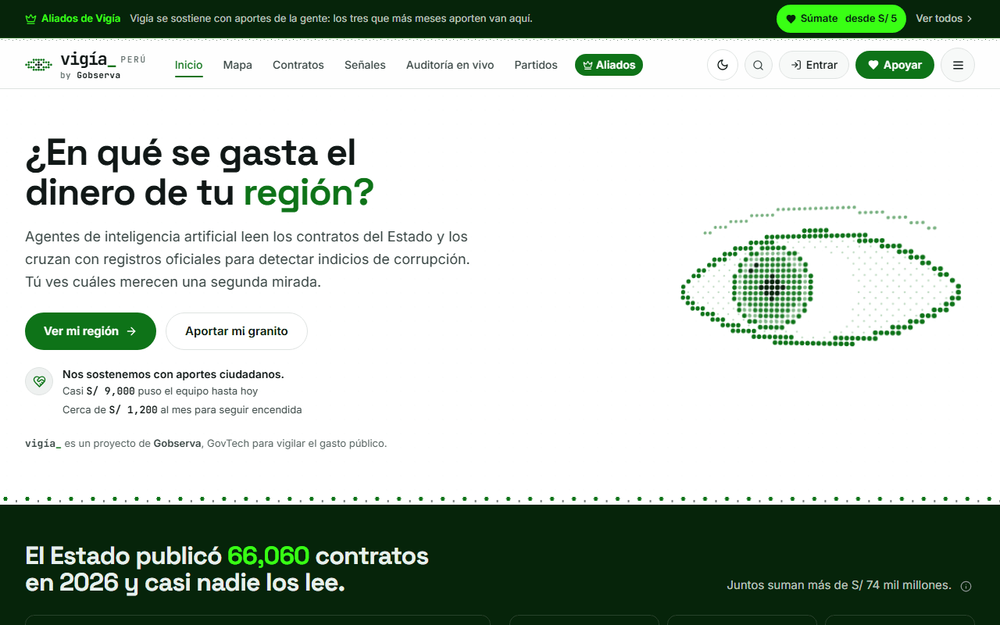
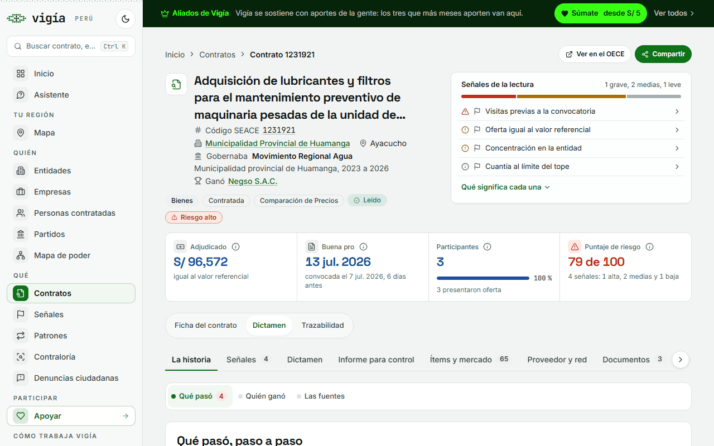
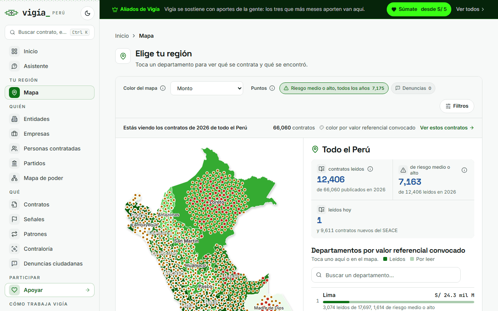
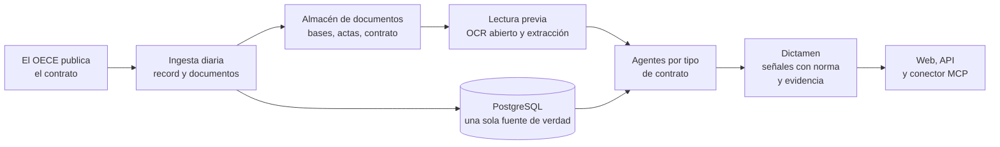

<div align="center">

# vigía_ Perú

**Leemos los contratos del Estado peruano para que cualquiera pueda vigilarlos.**

Un proyecto de [Gobserva](https://gobserva.cloud)

[](https://vigia.gobserva.cloud)
[](#licencia)
[](LICENSE)
[](#conector-mcp)

**[Abrir Vigía](https://vigia.gobserva.cloud)** &nbsp;|&nbsp;
**[Cómo se lee un contrato](#cómo-se-lee-un-contrato)** &nbsp;|&nbsp;
**[Señales](#qué-señales-busca)** &nbsp;|&nbsp;
**[Datos](#datos)** &nbsp;|&nbsp;
**[Correrlo](#correrlo-en-tu-máquina)** &nbsp;|&nbsp;
**[Licencia](#licencia)**



</div>

> **Si el Estado no lo hace, lo hacemos las personas.**
>
> En Gobserva creemos que vigilar el gasto público no puede depender de que el Estado se vigile a sí mismo. Los
> contratos ya son públicos; lo que faltaba era alguien que los leyera. Vigía los lee, los cruza con registros oficiales y
> los deja a la vista de todos, con la norma y el documento detrás de cada hallazgo.

## Por qué existe

Revisar un solo contrato del Estado puede tomarle días a una periodista: bases escaneadas de 80 páginas, actas dentro de
archivos RAR, datos repartidos en una docena de portales que no se hablan. Multiplicado por decenas de miles de
contratos al año, la vigilancia ciudadana se vuelve imposible. Vigía hace esa lectura con agentes de inteligencia
artificial y señala qué contratos merecen una segunda mirada.

| Al 24 de noviembre de 2026 | |
|---|---|
| Contratos publicados por el Estado en 2026 | **66 060**, por más de S/ 74 mil millones |
| Contratos de 2026 que Vigía ya leyó | **12 406** |
| Leídos con riesgo medio o alto | **7 163** |

Las cifras al día están en el [mapa](https://vigia.gobserva.cloud/app/mapa), y lo que cuesta cada lectura, en la
[auditoría en vivo](https://vigia.gobserva.cloud/app/auditoria).

> [!IMPORTANT]
> **Vigía no acusa a nadie.** Una señal es un motivo para revisar un contrato, nunca una acusación contra una empresa,
> una persona o un partido. Las denuncias corresponden a la Contraloría y a la Fiscalía.

## Qué puedes hacer

| | |
|---|---|
| **Ver tu región** | Un mapa con lo que se contrata en cada departamento, cuánto se leyó y qué se encontró. |
| **Leer un contrato** | La historia del proceso paso a paso, las señales con su norma y su evidencia, los ítems con sus precios frente a otras entidades, quién ganó y con quién está vinculado. |
| **Seguir a una entidad o empresa** | Sus contratos, sus proveedores, sus sanciones, quién la visitó y lo que ya observó la Contraloría. |
| **Ver los patrones** | Señales que se repiten en una entidad o un proveedor, y postores que solo aparecen para hacer número. |
| **Preguntarle a tu asistente de IA** | Con el [conector MCP](#conector-mcp), tu asistente consulta Vigía y responde con el enlace oficial de cada dato. |

<div align="center">


</div>

## Cómo se lee un contrato



1. **Ingesta.** Cada día entran los contratos nuevos del OECE (estándar OCDS) y sus documentos: PDF, Word, Excel, ZIP y
   RAR.
2. **Lectura previa.** Antes de analizar se lee todo: el texto de cada documento, las páginas escaneadas con OCR abierto
   ([Docling](https://github.com/docling-project/docling)) y las tablas de ítems. Un contrato no se analiza hasta que
   sus documentos están completos; lo que falta queda anotado y se vuelve a pedir.
3. **Análisis.** Cada tipo de contrato (bienes, servicios, obras, consultoría y contrataciones directas) tiene su
   perfil, y los pasos corren siempre en el mismo orden, fijado en el código y no decidido por un modelo:

   | Paso | Qué hace |
   |---|---|
   | Reglas | 28 reglas que no usan IA: competencia, proveedor, vínculos, plazos y montos |
   | Documentos | Lee bases, actas y contrato: ítems, cantidades, postores, ofertas y firmantes |
   | Norma | Contrasta el proceso con la ley vigente en su fecha y con las opiniones del OECE |
   | Mercado | Compara cada precio con lo que pagaron otras entidades por lo mismo |
   | Prensa y web | Busca lo publicado sobre el proveedor y la entidad |
   | Red | Socios, representantes, funcionarios, visitas a la entidad y aportes de campaña |
   | Dictamen | Redacta el resultado: cada señal con su norma, su evidencia y su peso |

4. **Publicación.** Cada señal sale con la norma que cita y el documento oficial del que viene. Sin enlace verificable,
   no se publica.

Leer un contrato completo cuesta en promedio unos **US$ 0.20** en modelos de lenguaje, y el OCR, menos de un décimo de
centavo por página.

## Qué señales busca

<details>
<summary><b>Las 28 reglas</b>, agrupadas</summary>

<br>

| Grupo | Qué mira |
|---|---|
| **Competencia** | Un solo postor con una oferta cercana al valor referencial; ofertas iguales al valor referencial; ofertas casi idénticas entre sí; una sola oferta válida; la oferta más barata que no gana; un ganador que no estaba entre los invitados; un mismo postor en casi todos los ítems |
| **Proveedor** | Sanción vigente; RUC con meses de vida; un giro que no tiene que ver con lo que vende; demasiadas buenas pro con la misma entidad; contrataciones directas que se repiten; la misma persona detrás de varias empresas ganadoras |
| **Vínculos** | Un firmante de la entidad vinculado al ganador o socio de una proveedora; postores con los mismos socios; visitas del ganador a la entidad antes de la convocatoria; personal clave vinculado en servicios |
| **Proceso** | Plazos de convocatoria cortos; un tipo de proceso que no corresponde al monto; contratación directa sin causal; procesos no competitivos; compras partidas para no licitar |
| **Documentos y ejecución** | Lo que dicen los documentos no cuadra con lo publicado; fechas incoherentes; adicionales de obra acumulados; ampliaciones denegadas con penalidad |

Sobre las reglas, el análisis de mercado, el legal y el de la red de personas suman sus propias señales.

</details>

## Principios

1. **No acusamos.** Una señal es un indicio para revisar, no una condena.
2. **Cuidamos a las personas.** Nunca mostramos un DNI, las personas naturales aparecen con un apellido tapado y un
   RUC 10 nunca se muestra ni se busca. Los funcionarios en ejercicio y las empresas que le venden al Estado no se tapan.
3. **No reemplazamos a nadie.** Ni a la Contraloría, ni a la Fiscalía, ni al periodismo: detectamos y priorizamos.
4. **Todo con evidencia.** Cada hallazgo enlaza a su fuente oficial y a la norma que aplica.
5. **Modelos abiertos.** El OCR y los modelos de lenguaje que leen los contratos son abiertos.
6. **Cuentas claras.** Lo que se gasta en leer contratos se publica en la auditoría en vivo.
7. **Sin anuncios.** Vigía se sostiene con aportes de la gente.

## Datos

Todo lo que muestra Vigía es información pública del Estado peruano. Los datos crudos no están en este repositorio: son
pesados y algunos traen datos personales que no publicamos.

| Fuente | Para qué |
|---|---|
| OECE y SEACE (Contrataciones Abiertas, OCDS) | Convocatorias, contratos, montos, postores y documentos |
| CONOSCE | Adjudicaciones por ítem y ofertas |
| Perú Compras | Órdenes de compra de catálogos |
| RNP y Tribunal de Contrataciones | Proveedores, sanciones y resoluciones |
| MEF | Presupuesto y gasto de cada entidad |
| SUNAT | Estado y antigüedad de las empresas |
| Contraloría y Procuraduría | Informes de control y procesos |
| JNE, Infogob y ONPE | Autoridades, candidaturas, quién gobierna cada lugar y aportes de campaña |
| Datos abiertos (PNDA) | Visitas a entidades, planillas, declaraciones y penalidades |

Más detalle en [`docs/DATA.md`](docs/DATA.md).

## Conector MCP

`https://mcp.gobserva.cloud/mcp` es un servidor [Model Context Protocol](https://modelcontextprotocol.io) de solo
lectura con más de 50 herramientas: buscar contratos, entidades y empresas, leer un dictamen, seguir la red de una
empresa, ver los patrones de una entidad, buscar informes de control y resoluciones del Tribunal, comparar precios y
más. Cada resultado trae su código (OCID, RUC, CUI), su enlace en Vigía y la fuente oficial. **Es gratis**: se conecta
con una cuenta de Gobserva que tenga el correo confirmado.

```text
> ¿Qué contratos de riesgo alto hay en Ayacucho este año?

  cada resultado trae:
    la señal y la norma que cita
    el documento oficial
    el enlace al dictamen en Vigía
```

## Arquitectura

| Pieza | Qué hace | Dónde corre |
|---|---|---|
| `frontend` (vigia-web) | El sitio, con Next.js 14 y OpenNext | Cloudflare Workers |
| `backend/api` (vigia-api) | API de lectura y escritura con Hono | Cloudflare Workers con Hyperdrive |
| `backend/mcp-worker` (vigia-mcp) | El conector MCP | Cloudflare Workers |
| `backend/scrapers-worker` (vigia-scrapers) | Ingesta de contratos, documentos y fuentes públicas | Cloudflare Workflows |
| `backend/ocr-worker` (vigia-ocr) | OCR abierto: Docling con RapidOCR y TableFormer | Cloudflare Containers |
| `backend/llm-worker` (vigia-llm) | Puerta única a los modelos de lenguaje abiertos | Workers AI |
| `backend/agent` | Los agentes en Python, un perfil por tipo de contrato | AWS Lambda |
| Base de datos | PostgreSQL con roles por componente | AWS RDS |
| Documentos | Copia de las bases, actas y contratos | Cloudflare R2 |

```text
vigia-peru/
├── frontend/              el sitio y la app
├── backend/
│   ├── agent/             agentes, lectura de documentos, reglas y dictamen
│   ├── api/               API (Hono)
│   ├── db/migrations/     migraciones SQL numeradas
│   ├── scrapers-worker/   ingesta en Cloudflare
│   ├── scrapers/          ingestas en Python
│   ├── ocr-worker/        OCR abierto en contenedor
│   ├── llm-worker/        modelos de lenguaje
│   ├── mcp-worker/        conector MCP
│   └── scripts/           lectura previa, análisis masivo y utilidades
├── infrastructure/        despliegue y configuración
└── docs/                  datos, marco normativo e imágenes
```

## Correrlo en tu máquina

Cada componente trae su `.env.example`.

```bash
# Base de datos: PostgreSQL con PostGIS
docker compose -f infrastructure/docker-compose.yml up -d
python backend/db/apply_all.py

# API
cd backend/api && npm install && cp .env.example .env && npm run dev
npm test

# Sitio
cd frontend && npm install && cp .env.example .env.local && npm run dev

# Agentes
cd backend/agent && pip install -r requirements.txt && python -m pytest

# Ingesta
cd backend/scrapers-worker && npm install && npm test
cd backend && pip install -r scrapers/requirements.txt && python -m pytest scrapers/tests
```

Las credenciales viven en variables de entorno o en el gestor de secretos, nunca en el repositorio.

## Parte de Gobserva

Vigía comparte código y datos con las otras apps de Gobserva, que viven en este mismo repositorio:

| App | Para qué |
|---|---|
| [Vigía](https://vigia.gobserva.cloud) | Vigilar los contratos del Estado |
| [Salud](https://salud.gobserva.cloud) | Verificar médicos, medicamentos y establecimientos de salud |
| [Empleo](https://empleo.gobserva.cloud) | Encontrar plazas CAS en el Estado |
| [Licitaciones](https://licitaciones.gobserva.cloud) | Encontrar procesos para venderle al Estado |
| [Obras](https://obras.gobserva.cloud) | Seguir las obras públicas |
| [Car](https://car.gobserva.cloud) | Consultar los registros del MTC: revisiones técnicas, licencias y conversiones a gas |

## Licencia

Vigía es **open source para uso personal y sin fines de lucro**: el código se publica bajo la
**[PolyForm Noncommercial License 1.0.0](LICENSE)**. En palabras simples (el texto legal es el que vale):

- **Puedes** usarlo, estudiarlo, modificarlo y compartirlo para cualquier fin no comercial: investigación, docencia,
  activismo, vigilancia ciudadana y proyectos personales.
- **Pueden usarlo sin pedir permiso** las organizaciones benéficas, los colegios y universidades, los centros de
  investigación públicos, las organizaciones de salud, seguridad pública o protección ambiental y las instituciones del
  Estado.
- **Al compartirlo** incluye la licencia y la línea `Required Notice` del archivo [`LICENSE`](LICENSE).
- **Para un uso comercial** (venderlo, ofrecerlo como servicio pagado o usarlo en una empresa con fines de lucro),
  escríbenos a [hello@gobserva.cloud](mailto:hello@gobserva.cloud) y lo conversamos.

La licencia cubre el código. Los datos que muestra Vigía son públicos y pertenecen a sus fuentes oficiales. Hasta el 24 de
noviembre de 2026 el código se publicó bajo la licencia MIT; las copias obtenidas antes de esa fecha conservan esa licencia.

## Súmate

- **Aporta** en [vigia.gobserva.cloud](https://vigia.gobserva.cloud): con los aportes ciudadanos se pagan las lecturas.
- **Avísanos de un error** en un dato o en un dictamen abriendo un issue o escribiéndonos a
  [hello@gobserva.cloud](mailto:hello@gobserva.cloud).
- **Úsalo** en tu universidad, tu colectivo o tu medio sin fines de lucro, y cuéntanos qué encontraste.

<div align="center">

**[vigia.gobserva.cloud](https://vigia.gobserva.cloud)** &nbsp;|&nbsp; **[gobserva.cloud](https://gobserva.cloud)** &nbsp;|&nbsp; **[hello@gobserva.cloud](mailto:hello@gobserva.cloud)**

Hecho en el Perú, para el Perú.

</div>
