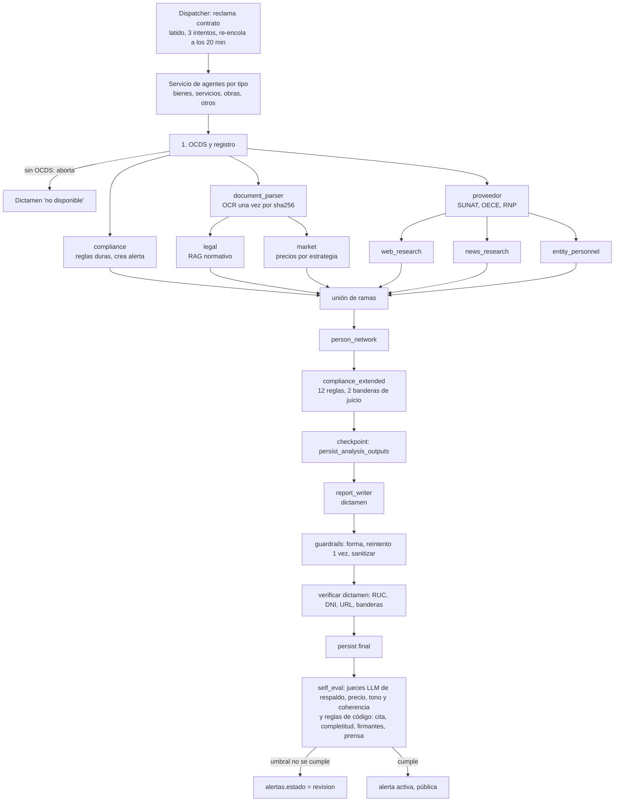
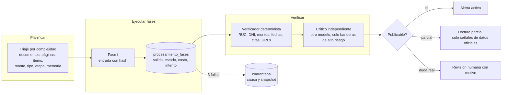
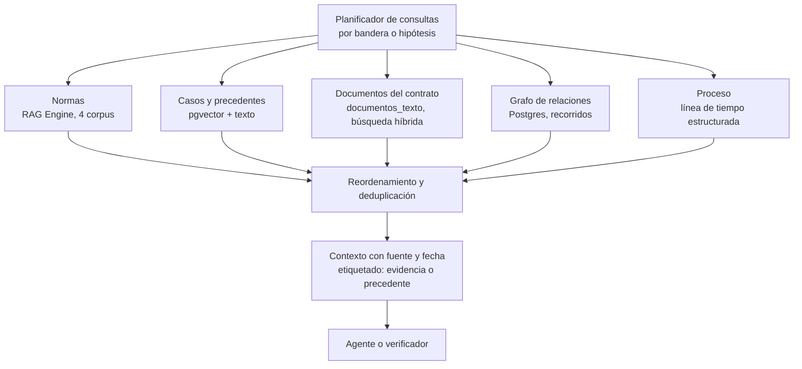
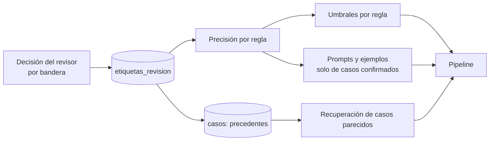

# Propuesta: agentes ADK más resistentes, que razonen mejor y que recuerden

Estado: propuesta para decisión, no implementada. Medido contra la base de producción (solo lectura) y el código de `backend/agent/` el 11 de octubre de 2026.

> **Resumen en cinco líneas**
> 1. El pipeline ya es sólido en lo básico: 200 de 200 procesamientos terminaron, en 7 minutos de mediana, a US$ 0,22 de mediana. El problema no es que falle, es que **cuando una pieza falla se rehace todo** y que **el 20 % de los análisis termina en revisión por una regla de umbral frágil**, no por un hallazgo malo.
> 2. Lo más débil son los juicios derivados de modelo y de mercado: las banderas de sobreprecio solo se sostienen en 41 % a 47 % según el propio juez, mientras que las reglas que salen de datos oficiales (sanciones, penalidades, plazos) se sostienen al 100 %.
> 3. **No hay memoria entre análisis**: cada contrato empieza de cero aunque el 57 % de las alertas pertenece a una entidad que tiene otra alerta.
> 4. **No hay etiquetas humanas guardadas**: ninguna de las 266 alertas tiene una decisión de revisor registrada. Sin eso no se puede medir ni mejorar con rigor.
> 5. Se recomienda mantener el pipeline determinista y agregar **checkpoints por fase en la base**, un **verificador de hipótesis** por bandera, **memoria de casos y de procesos** con recuperación híbrida, y un **conjunto dorado** que mida cada cambio antes de desplegarlo.

Nota de método. Las skills `google-agents-cli-*` pedidas no estaban disponibles como skills invocables en esta sesión; en su lugar verifiqué cada afirmación sobre ADK contra la documentación oficial en `adk.dev` (citada en el anexo A). Lo que no se pudo medir se dice como tal en el anexo B.

---

## 1. Diagnóstico

### 1.1 El pipeline actual

El orquestador-LLM se abandonó en junio porque "se rendía" a mitad de la secuencia. Hoy la secuencia corre en código (`deterministic.py`), con un DAG de ramas paralelas.



Referencias: DAG y dependencias en `deterministic.py:304-341`; ejecución en `deterministic.py:444-458`; sesión de ADK en memoria en `main_stream.py:64`; fases en `pipeline_phases.py:169-648`.

### 1.2 Lo que funciona (con cifras)

| Medida | Valor | Fuente |
|---|---|---|
| Procesamientos terminados | 200 de 200 en estado `procesado` | `procesamientos` |
| Duración total | media 8,1 min, mediana 7,0, p90 14,2, máximo 30,8 | `procesamientos` |
| Procesamientos que necesitaron más de 1 intento | 9 de 200 (4,5 %): 8 con 2 intentos y 1 con 3 | `procesamientos.intentos` |
| Costo de LLM por análisis | media US$ 0,236; mediana 0,219; p90 0,369; máximo 0,837 (230 análisis; total US$ 54,19) | `alertas.analisis_full.llm_metrics` |
| Llamadas por análisis | 23,9 de media; unos 326 mil tokens | idem |
| Dictamen | 11 de 266 alertas sin dictamen utilizable (menos de 500 caracteres) | `alertas.dictamen_markdown` |
| Datos nunca inventados | `verificacion_dictamen.degradado = false` en el lote 1 revisado a mano; RUC, DNI y URLs se verifican contra OCDS, SUNAT, RNP y texto | `tools/verify.py:599` |
| Cache de documentos | 1.157 documentos de 209 contratos con texto y extracción cacheados por sha256 | `documentos_texto` |

Tiempo por fase (minutos, media y p90; las fases del DAG se solapan, por eso no suman el total):

| Fase | Media | p90 |
|---|---|---|
| compliance | 2,49 | 4,70 |
| web_research, entity_personnel (en paralelo) | 2,31 | 4,56 |
| news_research | 2,12 | 4,47 |
| document_parser | 1,64 | 3,57 |
| report_writer | 0,86 | 1,39 |
| legal, market | 0,84 | 1,45 |
| person_network | 0,66 | 0,88 |
| compliance_extended, self_eval | 0,26 y 0,25 | 0,37 |

### 1.3 Modos de fallo reales

**F1. Un fallo a mitad de camino obliga a rehacer todo.** La corrida vive en un solo proceso, con la sesión de ADK en memoria (`main_stream.py:64`, `InMemorySessionService`). El único punto de persistencia intermedio es `persist_checkpoint` antes del dictamen (`pipeline_phases.py:649`), y el estado de los agentes no se puede reanudar desde ahí. Si la instancia muere, el dispatcher re-encola a los 20 minutos sin latido y con tope de 3 intentos (`dispatcher-worker/src/ciclo.ts:134`, `config.ts:51`); la corrida arranca de cero y solo se ahorran el OCR y la extracción cacheados por sha256. Evidencia: 9 de 200 procesamientos (4,5 %) tuvieron más de un intento. No se midió cuánto costó ese retrabajo (ver anexo B).

**F2. El umbral de revisión es frágil con pocas banderas.** `debe_bloquear` (`tools/self_eval.py:73-110`) manda a revisión si el respaldo es menor que 60 % con al menos 2 banderas juzgadas. De 266 alertas, 53 (20 %) están en revisión. De esas 53:

| Causa (pueden coincidir) | Alertas |
|---|---|
| respaldo de banderas menor que 60 % | 40 |
| plausibilidad de precio menor que 50 % | 18 |
| tono acusatorio | 2 |
| ítems incoherentes con el objeto | 2 |

De las 40 por respaldo, **29 tenían 3 banderas juzgadas o menos** y **25 tienen exactamente 50 %** (típicamente 1 de 2 banderas sin respaldo). Con n pequeño, una sola bandera dudosa basta para frenar un análisis completo. Es una regla de conteo, no de riesgo.

**F3. Las banderas derivadas de modelo son las menos fiables.** Respaldo por regla según el juez LLM (reglas con al menos 5 casos):

| Regla | Casos | Respaldada |
|---|---|---|
| ampliacion_denegada_penalidad | 8 | 13 % |
| unico_postor_alto | 16 | 38 % |
| sobreprecio_elevado | 32 | 41 % |
| sobreprecio_muy_elevado | 47 | 47 % |
| sobreprecio_lote_muy_elevado | 9 | 56 % |
| postores_vinculados_rnp | 51 | 76 % |
| red_flag_documental | 61 | 80 % |
| firmante_con_empresa_rnp | 128 | 85 % |
| sancion_historica_oece, sancion_vigente_oece, penalidades_oece_historicas, cobertura_prensa_adversa, concentracion_entidad, plazo_convocatoria_minimo | 7 a 26 cada una | 100 % |

El patrón es claro: lo que sale de **datos oficiales** (OECE, plazos) se sostiene; lo que sale de **comparables de mercado, texto de bases y prensa** se discute. Es donde debe ir el esfuerzo de razonamiento. Nota: que el juez diga "no respaldada" no prueba que la bandera sea falsa, mide que el juez no la pudo sostener; hace falta contrastar con etiquetas humanas (F6).

**F4. Se descarta mucha salida de modelo en las fronteras.** 191 de 266 alertas tienen al menos un descarte. Motivos principales: `item_invalido` 159, `juez_precio_implausible` 130, `bloque_invalido` 126, `outlier` 48, `delta_implausible` 27, `precio_sin_grounding` 22. Por origen: `persist_analysis_outputs` 399, `person_network` 207, `self_eval` 130, `market` 116, `web_research` 86. La causa de fondo ya está documentada: los agentes con `google_search` no pueden usar `response_schema` sin vaciar los `grounding_chunks`, así que escriben JSON en texto y se valida después (`deterministic.py:230-289`, segunda llamada de reestructuración en `tools/estructurar.py`). Funciona, pero cuesta una llamada extra y aun así pierde ítems.

**F5. Salidas degeneradas y vacías.** Ya se mitigaron con parches puntuales: dictamen malformado con reintento y saneado (`pipeline_phases.py:684-729`), salida vacía con reintento y valor por defecto tipado (`pipeline_phases.py:123-148`), `thought_signature` con demasiadas llamadas (el `report_writer` quedó con una sola herramienta). Son correctos, pero **cada uno es un parche local**; no hay una política común de reintentos, presupuesto y degradación por fase.

**F6. No hay etiquetas humanas guardadas.** `alertas.moderacion` es nulo en las 266 alertas y la bitácora no tiene acciones de revisión. Las únicas etiquetas son las 10 revisiones manuales del lote 1 (`docs/design/revision_contratos/`: 10 de 10 falsos positivos eliminados y 17 de 21 falsos negativos recuperados tras las correcciones) y la revisión pendiente del lote 2. Sin un conjunto dorado, cada mejora se valida a ojo.

**F7. No hay memoria entre análisis.** Cada contrato empieza de cero. En la base: 266 alertas, 164 entidades distintas, 222 proveedores distintos. El 57 % de las alertas (151) pertenece a una entidad con otra alerta, y el 18 % (47) a un proveedor con otra alerta. La investigación web y de prensa se repite por contrato.

**F8. El RAG normativo no tiene una medida de calidad cerrada.** Hay 4 corpus en RAG Engine con cascada de respaldo a Vertex AI Search y pgvector (`tools/legal.py:396-420`). La evaluación de `recall@5` quedó incompleta: 0,14 en la medición parcial por cuota de embeddings (429), y 1,0 solo sobre las 17 consultas que respondieron (`docs/design/RAG_NORMATIVO.md`). El resultado final con los 4 corpus completos no está anotado.

---

## 2. Arquitectura más resistente

Principio rector: **lo que se puede decidir en código, se decide en código; el LLM se usa en nodos acotados con contrato de entrada y salida, presupuesto y verificación**. Es lo que ya hace el pipeline; la propuesta es llevarlo hasta el final.



### 2.1 Ejecución durable y reanudable por fase

| Pieza | Qué hace | Por qué |
|---|---|---|
| Tabla `procesamiento_fases` | Una fila por `(ocid, fase, intento)` con `entrada_hash`, `salida jsonb`, `estado`, `duracion_s`, `costo_usd`, `modelo`, `error` | Hoy `procesamientos.fases` guarda tiempos y mensajes, no las salidas |
| Reanudación por hash de entrada | Al reintentar, el driver salta las fases cuya `entrada_hash` ya tiene salida válida y rehace solo desde la primera que falló | Evita pagar de nuevo web, prensa, funcionarios, legal y mercado tras una caída |
| Fases idempotentes | Cada fase solo escribe sus claves del `state` (ya está documentado en `deterministic.py:323-336`) y las escrituras a la base usan el candado por OCID que ya existe | Permite reintentar sin duplicar banderas |
| Reintentos con presupuesto por fase | Máximo de reintentos, tiempo y costo por fase, con retroceso exponencial y variación aleatoria | Hoy la única capa de reintentos es la de llamadas a Gemini (`model_fallback.py:43-47`, techo de 600 s por llamada) |
| Cortacircuitos por dependencia | Estado "abierto" para OECE, Document AI, SUNAT, RAG Engine y búsqueda web tras N fallos; la fase se omite y se anota como no verificable | Flex ya tiene su cortacircuito (`tools/flex.py:15-16`); falta el resto |
| Cuarentena de contratos "veneno" | Tras 3 fallos con la misma causa determinista, el contrato pasa a `cuarentena` con causa, snapshot y fecha, sin consumir más cola; se reabre desde el panel | Hoy pasa a `error` y se pierde la pista de por qué |
| Clasificación de errores | Transitorio (429, 503, tiempo) frente a determinista (esquema, documento ilegible) | El primero se reintenta, el segundo se cuarentena |
| Tiempos por fase | Cada fase con su propio plazo; si se excede, degrada en lugar de esperar al muro de Cloud Run | Hoy el único corte global es el de la corrida (Flex) y el muro de 3600 s |
| Degradación elegante | Si faltan fases que no son de datos oficiales, publicar como **lectura parcial** solo las señales deterministas (sanciones, penalidades, plazos, vínculos RNP), etiquetada y sin dictamen largo | Mejor una señal parcial y honesta que nada o un análisis bloqueado |

**Sobre `ResumabilityConfig` de ADK.** La documentación oficial describe `ResumabilityConfig(is_resumable=True)` (disponible desde Python 1.16; el repo está en 1.19.0), que registra los eventos completados y rehace solo el paso fallido, pero los eventos deben sobrevivir a la caída: con `InMemorySessionService` se pierden al reiniciar, y la alternativa serían `DatabaseSessionService` o `VertexAiSessionService`. Además, las herramientas se ejecutan "al menos una vez". Como el pipeline no es una conversación sino un DAG de código con una sesión fresca por agente, **la recomendación es la tabla propia de checkpoints** y dejar la reanudación nativa de ADK como opción a evaluar si algún día se pasa a sesiones persistentes (por verificar con una prueba, no está probada aquí).

### 2.2 Separar planificar, ejecutar y verificar

| Rol | Qué es | Cambia respecto a hoy |
|---|---|---|
| Planificador | Función determinista que, con rasgos baratos (tipo, etapa, páginas, ítems, monto, memoria disponible), decide qué fases corren y con qué modelo | Hoy la matriz tipo por etapa y los perfiles ya deciden qué agentes corren (`permitido`, `deterministic.py:151`); se amplía con complejidad y memoria |
| Ejecutores especializados | Los agentes actuales, cada uno con contrato de entrada y de salida versionados | Ya existen esquemas en `agents/_shared/schemas`; falta versionarlos y probar cada frontera |
| Verificador determinista | Cotejo de RUC, DNI, montos, fechas, URLs, citas y páginas contra OCDS, SUNAT, RNP y el texto del documento | Ya existe para el dictamen y las banderas (`tools/verify.py`); se amplía a **todas** las afirmaciones con cifra |
| Crítico independiente | Un modelo distinto del que generó (ya hay juez distinto del generador) que intenta **refutar** la bandera | Hoy los jueces califican; no buscan contraevidencia |

### 2.3 Contratos de entrada y salida en cada frontera

1. Esquema Pydantic con versión (`schema_version`) en cada `output_key` y rechazo explícito si falta un campo obligatorio de **fuente** (documento, página o URL).
2. Campos que la fuente suele no traer, opcionales (lección de `NotaPrensa.titulo`).
3. Pruebas de contrato con salidas reales grabadas (los descartes de producción son un buen banco: 159 `item_invalido`).
4. Mantener `tools/estructurar.py`, pero medir cuántas veces rescata ítems frente a cuánto cuesta.

---

## 3. Razonar mejor

### 3.1 Triaje y enrutamiento de modelos

Hoy el costo y el tiempo dependen poco de la complejidad del contrato: casi todos corren las mismas fases. Propuesta: tres rutas.

| Ruta | Cuándo | Qué corre | Modelo |
|---|---|---|---|
| Ligera | Pocos documentos y páginas, sin señales de reglas oficiales, entidad y proveedor ya conocidos y sin novedades en memoria | Reglas deterministas, verificador, dictamen breve | Familia flash-lite y reglas en código |
| Estándar | El resto | Pipeline actual | `gemini-3.6-flash` con razonamiento por agente |
| Profunda | Monto alto, bandera alta derivada de modelo, vínculos de red, documentos pesados | Pipeline completo más crítico y autoconsistencia en las banderas de alto riesgo | Segundo modelo como crítico |

Criterio de éxito: bajar el costo mediano sin subir los falsos negativos del conjunto dorado (sección 5). La mediana actual es US$ 0,219 y el p90 US$ 0,369.

### 3.2 Razonamiento por hipótesis, con evidencia y contraevidencia

Cada bandera deja de ser una frase y pasa a ser un registro verificable:

```text
hipótesis      "El precio unitario del ítem 3 supera en 41 % el comparable"
evidencia_pro  [{fuente: documento sha256 + página, cita, valor}, {fuente: URL verificada, precio}]
evidencia_con  [{fuente, cita, valor}]      # búsqueda explícita de lo que la desmiente
verificación   {ok, motivos}                # verificador determinista
confianza      0 a 1, calibrada por regla    # sección 3.5
estado         respaldada | no_respaldada | no_evaluada
```

Reglas:
1. **Sin evidencia pro verificable, no se publica** (ya es la regla de producto; hoy la aplica el verificador y el juez).
2. **Contraevidencia obligatoria** para banderas derivadas de modelo (sobreprecio, documental, prensa): una consulta dirigida a lo que la desmentiría (otra unidad, otra marca, otro comparable, resolución posterior).
3. Para sobreprecio, **normalizar y comparar con el histórico propio** (la estrategia `historico_seace` ya existe, informativa por defecto) antes de recurrir a búsqueda web; es la bandera con peor respaldo (41 % a 47 %).

### 3.3 Reflexión acotada

Patrón generador-crítico-corrector, el que describe la documentación de ADK con `LoopAgent(sub_agents=[critico, corrector], max_iterations=N)` y salida anticipada con `tool_context.actions.escalate`. Aplicarlo solo donde el valor es claro:

| Dónde | Máximo de vueltas | Salida anticipada |
|---|---|---|
| Veredicto de precio por ítem | 2 | El crítico confirma el comparable |
| Dictamen (reemplaza el reintento manual de `pipeline_phases.py:684`) | 2 | Forma válida y verificador sin hallazgos |
| Banderas de texto de bases | 1 | Contraevidencia vacía |

Como el pipeline es un driver en código, no hace falta adoptar `LoopAgent`: basta con el mismo patrón en una función con tope duro. Si algún día se migra a ADK 2.0 (flujos de grafo, ver anexo A), el patrón se mapea directo.

### 3.4 Autoconsistencia donde duele

Muestrear 3 veces y exigir 2 de 3 de acuerdo solo para **banderas altas derivadas de modelo**, no para las que salen de datos oficiales. En producción 171 de 226 alertas con banderas tienen al menos una "alta", pero la mayoría son de reglas deterministas (por ejemplo sanciones vigentes); 47 alertas tienen alguna bandera de sobreprecio. Con el costo medio actual, repetir solo esa etapa es una fracción pequeña de los US$ 0,22 por análisis (no se midió el costo por etapa: ver anexo B).

### 3.5 Calibración y umbrales por regla

1. Reemplazar el umbral global de respaldo por un **umbral por regla**, estimado con el conjunto dorado (sección 5). Reglas con 100 % de respaldo no necesitan juez; reglas de mercado sí.
2. Reemplazar el cociente con n pequeño por una **cota inferior** (por ejemplo la de Wilson) o por una regla de dos condiciones: frenar si hay **una bandera alta sin respaldo**, no si "1 de 2 no se respalda". Con esto, los 25 casos de exactamente 50 % dejarían de bloquearse automáticamente por conteo.
3. Registrar siempre el **motivo del bloqueo** con la bandera responsable, para que el revisor vea qué mirar (ya se guarda el motivo en texto).

### 3.6 Cadena de evidencias auditable

Cada afirmación del dictamen enlaza a su registro de hipótesis y este a sus fuentes (documento más página, o URL verificada). Ya existe la base: evidencia `{documento_sha256, pagina, cita}` cotejada contra el texto (`tools/documentos/evidencia.py`) y `verificacion_dictamen`. Falta que la **interfaz** muestre la cadena completa, que es lo que hace confiable la señal para un periodista.

### 3.7 Por qué el pipeline determinista sigue siendo la base

| Evidencia | Lectura |
|---|---|
| El orquestador-LLM "se rendía" y dejaba secciones vacías sin aviso | La secuencia no debe depender de que un modelo decida llamar al siguiente paso |
| 200 de 200 procesamientos terminados con el driver en código | La secuencia fija es fiable |
| La regla "lo determinista va en código, el LLM solo para juicio" resolvió varios parches (por ejemplo `evaluate_normative_compliance` movida al driver) | Reducir el trabajo del LLM mejora la estabilidad |
| Un subagente con razonamiento que encadena varias herramientas pierde `thought_signature` | Acotar el número de turnos agénticos por nodo |

---

## 4. Recuperación de información y RAG sobre procesos



### 4.1 Memoria de casos y precedentes

| Qué se guarda | Dónde | Para qué |
|---|---|---|
| "Ficha de caso" por alerta: objeto, tipo, etapa, entidad, proveedor, banderas con su veredicto, resumen del dictamen, **decisión humana** cuando exista | Tabla `casos` con `embedding` (pgvector, ya se usa para las 721 opiniones) más `tsvector` | Recuperar "casos parecidos y qué pasó" al planificar y al juzgar |
| Opiniones OECE y criterios | Ya están (721 con embedding, y el corpus `criterios-vinculantes`) | Sin cambios |
| Resoluciones de los revisores | `etiquetas_revision` (sección 5) | Aprender qué reglas aciertan |

Un precedente **nunca** entra al contexto como evidencia: se etiqueta "precedente" y puede orientar la búsqueda, pero la bandera se sigue sosteniendo solo con evidencia del propio contrato.

### 4.2 RAG agéntico con planificación de consultas y fuentes múltiples

1. Por cada hipótesis (sección 3.2), un **plan de consulta** corto: qué fuente, qué pregunta, qué filtro (entidad, año, tipo).
2. Fuentes: normas (RAG Engine), casos (pgvector), documentos del contrato (búsqueda híbrida), grafo (SQL) y proceso (línea de tiempo).
3. **Recuperación híbrida y reordenamiento**: texto completo (`tsvector`) más vectores, fusión por rango recíproco y un reordenamiento final. La opción concreta de reordenador (modelo de reranking o servicio gestionado) debe verificarse antes de elegirla; no está probada aquí.
4. Tope de contexto por fuente y registro de qué se recuperó, para auditar.

### 4.3 Documentos: búsqueda híbrida sobre `documentos_texto`

Hoy el texto completo se pasa al modelo y el dictamen se arma con contexto acotado a mano. En `documentos_texto` hay 1.157 documentos (media de 28 páginas, máximo 362; 75 MB de texto) con marcas de página `⟦p.N⟧`. Propuesta: indexar por **fragmentos con página** (`tsvector` más embedding), recuperar solo los pasajes relevantes por hipótesis y citar con página. Reduce tokens y mejora la cita, que es donde más se pierde.

### 4.4 Grafo de relaciones en Postgres

Ya hay las tablas: `empresas` (9.842), `postores`, `ofertas`, `peps` (38.400), `rnp_conformacion_juridica` (1,4 millones), `dji_funcionarios` y `dji_empleos` (1,8 y 2,7 millones), `onpe_aportantes`, `jne_candidaturas`, `osce_sancionados`, `penalidades` (12.309), `visitas_entidades`. Propuesta: vistas y una herramienta `vecinos(ruc, profundidad)` basada en consultas recursivas (CTE) que devuelva los caminos proveedor, socio, funcionario, donante, entidad con la **fuente de cada arista**. No hace falta una base de grafos; el volumen cabe en Postgres con los índices adecuados.

### 4.5 Memoria entre análisis por RUC

Ya identificada como siguiente paso de costo. Propuesta mínima:

| Tabla | Clave | Contenido | Vigencia |
|---|---|---|---|
| `memoria_proveedor` | RUC | hallazgos web y de prensa con URL y fecha, perfil SUNAT, vínculos | 30 días, o hasta que cambie el dato de origen |
| `memoria_entidad` | RUC y año | estadísticos de la entidad (modalidades, concentración, historial de alertas) | por trimestre |

Se consulta antes de lanzar `web_research` y `news_research`: si hay entrada vigente y sin novedad, se reutiliza y se anota. Ahorro esperado: por proveedor repetido (18 % de las alertas) y por entidad repetida (57 %); el efecto en costo exacto no se midió (anexo B).

### 4.6 "RAG de procesos": el proceso como contexto estructurado

Hoy se lee el expediente como texto. Propuesta: construir de forma **determinista** una línea de tiempo por contrato en `proceso_eventos`:

```text
ocid, orden, fecha, tipo, fuente
convocatoria          fecha de publicación, plazo para ofertas, VR
consultas y absolución
buena pro             ganador, monto, ofertas recibidas
consentimiento y contrato
adendas y ampliaciones monto, plazo, causal
penalidades           monto, causal
```

Fuentes: el registro OCDS (`convocatorias.ocds_payload`), `postores`, `ofertas`, `penalidades` y los documentos. Con esto se calculan reglas de proceso sin LLM (plazos, saltos de etapa, adendas contra monto) y se recupera "procesos parecidos" (mismo tipo, procedimiento y rango de monto, misma entidad) como contexto para el agente.

### 4.7 Cómo evitar contaminación

| Riesgo | Control |
|---|---|
| Datos personales en la memoria o en trazas | Aplicar el enmascarado de DNI antes de guardar y de enviar a Phoenix; en la memoria, solo personas con cargo público y fuente |
| Hechos sin fuente | Ninguna entrada de memoria sin `fuente_url` o `documento_sha256` más página y fecha |
| Un caso contamina a otro | Etiqueta `precedente` separada de `evidencia`; el verificador no acepta precedentes como respaldo |
| Información vieja | Vigencia por entrada e invalidación cuando cambia el dato de origen |
| Homónimos | Coincidencia por nombre solo con umbral alto y confirmación por documento (la regla `firmante_con_empresa_rnp` aparece en 128 banderas y su tasa de falsos positivos por homónimo aún no se midió) |

---

## 5. Evaluación y mejora continua

### 5.1 Conjunto dorado

Hoy hay 20 contratos de bienes revisados o por revisar a mano (10 hechos del lote 1; 10 del lote 2 pendientes de revisión) y **0 decisiones humanas guardadas**. Plan:

1. Tabla `etiquetas_revision`: `(alerta_id, bandera_id, veredicto humano: verdadero, falso positivo, no concluyente; motivo; revisor; fecha)`. El panel de revisión ya existe; solo hay que **guardar la decisión por bandera**, no solo el estado de la alerta.
2. Etiquetar primero las **53 alertas en revisión** (es la cola real) y una muestra de activas.
3. Objetivo inicial: 100 contratos etiquetados, repartidos por tipo.

### 5.2 Evalsets de ADK y métricas propias

Según la documentación oficial: archivos `.evalset.json` (varias evaluaciones, cada una con `eval_id` y `session_input`) o `.test.json` para pruebas rápidas; configuración de umbrales en `test_config.json` bajo `criteria`; comando `adk eval <agente> <evalset> --config_file_path=... --print_detailed_results` o `AgentEvaluator.evaluate(...)` con pytest. Métricas integradas útiles: `tool_trajectory_avg_score`, `final_response_match_v2`, `rubric_based_final_response_quality_v1`, `hallucinations_v1`, `safety_v1`, y las de eficiencia (`token_usage_v1`, `invocation_duration_v1`) que informan sin aprobar ni reprobar.

Importante: el pipeline es un driver en código, no un agente raíz con herramientas; las evaluaciones de ADK se ajustan mejor a los **agentes individuales** (document_parser, legal, report_writer) que al flujo completo. Para el flujo completo, usar pruebas propias sobre el conjunto dorado.

| Métrica propia | Cómo se mide |
|---|---|
| Precisión y cobertura por regla | Contra `etiquetas_revision` |
| Tasa de citas verificadas | `verificacion_dictamen` (ya existe) |
| Tono no acusatorio | Juez actual más muestras humanas |
| Costo y latencia por análisis | `llm_metrics` y `procesamientos` (ya existen) |
| Tasa de bloqueo a revisión y sus causas | `alertas.estado` y motivo |

### 5.3 Compuertas de regresión y A/B

1. Hoy hay 282 pruebas unitarias y 32 en vivo (según el informe de costos) pero no encontré una ejecución automática: no hay `.github/workflows` y el `cloudbuild.yaml` de la raíz no invoca `pytest`. Agregar una ejecución automática en cada cambio de `backend/agent/`.
2. **Compuerta**: no desplegar si baja la cobertura de reglas sobre el conjunto dorado, sube el costo mediano más de un umbral o aparece un descarte nuevo de tipo `schema_invalido`.
3. **A/B de prompts y modelos en sombra**: re-ejecutar los contratos dorados con la variante, usando los documentos ya cacheados por sha256 (cuesta una fracción de un análisis nuevo) y comparar contra las etiquetas.

### 5.4 Bucle de aprendizaje desde los revisores



---

## 6. Costos y operación

| Palanca | Qué es | Estado | Nota |
|---|---|---|---|
| Flex por llamada con escape a estándar | Ya desplegado | En producción | Ahorro medido en septiembre; ver informe de costos |
| API por lotes de Vertex AI | Para lecturas no urgentes (los aportes pagados no necesitan respuesta en segundos) | Propuesta | El informe interno anota que Flex y lotes conservan el 50 % de descuento; **verificar la tarifa vigente antes de decidir**, no se comprobó en esta sesión |
| Caché por sha256 | Documentos y extracción | En producción | 1.157 documentos |
| Caché y memoria por RUC | Sección 4.5 | Propuesta | Requiere migración |
| Presupuesto por contrato | Tope blando (por ejemplo, pasar a ruta ligera al superar un costo) y tope duro | Propuesta | Datos: mediana US$ 0,219; p90 0,369; 8 de 230 análisis pasaron de US$ 0,50 |
| Observabilidad de extremo a extremo | Trazas por fase, alertas cuando el p90 de una fase sube, tasa de reintentos y de cuarentena | Parcial (Arize Phoenix con trazas y costo) | Falta alertar sobre tiempos y tasa de fallos |

**Cloud Run frente a Agent Runtime.** La documentación de ADK lista Agent Runtime como servicio gestionado con escalado automático y Cloud Run como contenedor con escalado automático; la página de despliegue **no dice** nada sobre durabilidad ni ejecuciones largas. Hoy los agentes corren en Cloud Run con 3600 s de límite, instancias mínimas en 0 y un dispatcher en Cloudflare que reintenta.

| Opción | A favor | En contra |
|---|---|---|
| Mantener Cloud Run con checkpoints propios (recomendado) | Cero migración; durabilidad bajo nuestro control; costo bajo | Hay que mantener el orquestador de reintentos (ya existe en el dispatcher) |
| Migrar a Agent Runtime | Gestión de sesiones y memoria (Memory Bank) sin servidor propio | Migración de un pipeline con parches al SDK (monkey patch de `model_fallback`, Flex, instrumentación de Arize); durabilidad no confirmada; costo adicional por verificar |

---

## 7. Plan por fases

| Fase | Qué | Esfuerzo (persona-días) | Depende de | Criterio de éxito medible |
|---|---|---|---|---|
| **0. Una semana** | (a) Guardar decisión por bandera en `etiquetas_revision` y etiquetar las 53 en revisión; (b) cambiar el umbral de respaldo para n pequeño (cota inferior o "bandera alta sin respaldo"); (c) anotar el `recall@5` final del RAG y re-medir; (d) alertas de tiempo y tasa de reintentos | 4 a 6 | Revisor humano para (a) | Alertas en revisión por conteo (25 hoy con 50 % exacto) baja a 0 sin subir falsos positivos; recall@5 anotado |
| **1. Resistencia** | Tabla `procesamiento_fases`, reanudación por hash, cuarentena, clasificación de errores, presupuesto y tiempo por fase, cortacircuitos por dependencia, lectura parcial | 10 a 14 | Fase 0 | Reintentos sin rehacer fases ya hechas; tasa de reproceso medida; ningún contrato reintentado más de 3 veces sin causa registrada |
| **2. Razonamiento y memoria** | Registro de hipótesis con contraevidencia, crítico en banderas de mercado y texto, triaje con ruta ligera, memoria por RUC y entidad, tabla `casos` con pgvector, `proceso_eventos` | 15 a 22 | Fases 0 y 1; conjunto dorado de al menos 50 | Costo mediano por análisis menor que hoy con cobertura de reglas igual o mayor en el conjunto dorado; respaldo de banderas de sobreprecio por encima de 70 % |
| **3. Aprendizaje y escala** | CI con compuertas de regresión, A/B en sombra, umbrales por regla, búsqueda híbrida sobre `documentos_texto`, API por lotes, decisión sobre ADK 2.0 y Agent Runtime | 10 a 15 | Fase 2; 100 contratos etiquetados | Cada despliegue pasa la compuerta; mejora continua medible por trimestre |

Riesgos principales: el conjunto dorado depende del tiempo de revisión humana; la memoria agrega superficie de contaminación (sección 4.7); el reordenamiento y la búsqueda híbrida necesitan elegir y probar un componente; el costo de lotes depende de una tarifa por verificar.

### Decisiones que necesitan al usuario

| Decisión | Opciones | Recomendación |
|---|---|---|
| ¿Quién etiqueta las 53 alertas en revisión y con qué criterio? | El usuario, un revisor del equipo, o ambos | Empezar por el usuario en una sesión corta; sin etiquetas no hay mejora medible |
| Política de lectura parcial | Publicar señales deterministas con etiqueta, o no publicar nada si falla una fase | Publicar parcial, etiquetada |
| Migración de base de datos | Autorizar tablas `procesamiento_fases`, `etiquetas_revision`, `casos`, `memoria_*`, `proceso_eventos` | Autorizar por fases: primero las dos primeras |
| Presupuesto por contrato | Tope blando y duro en dólares | Partir del p90 actual (US$ 0,37) como tope blando |
| Cola con lotes de Vertex AI | Usar lotes para aportes no urgentes | Verificar tarifa y plazos antes de decidir |
| ADK 2.0 y Agent Runtime | Ahora, después o nunca | Después de la fase 2; no hay urgencia |

---

## 8. Lo que no se recomienda hacer

| No hacer | Por qué |
|---|---|
| Volver a un orquestador-LLM libre | Ya se probó y se rendía a mitad de la secuencia, dejando secciones vacías sin aviso |
| Pasar todo a microservicios por agente | Hoy hay cuatro servicios por tipo de contrato y un solo código; más piezas suman fallos de red y de cuota sin ganar fiabilidad |
| Reescribir sobre ADK 2.0 ahora | El repo está en 1.19.0 y depende de parches (reintentos, Flex, instrumentación); la documentación indica que los flujos de grafo son de ADK 2.0 o superior; no hay urgencia ni prueba de compatibilidad |
| Base de grafos o base vectorial aparte | El volumen cabe en Postgres con índices; menos piezas que operar |
| Subir umbrales globales "a ojo" | Ya hay evidencia de que el cociente con pocas banderas bloquea por conteo; mejor umbrales por regla con etiquetas |
| Usar precedentes como evidencia | Un caso previo orienta, no prueba; mezclar ambos contamina |
| Pedir más razonamiento a todos los agentes | Un agente con razonamiento que encadena varias herramientas perdió `thought_signature`; mejor acotar turnos y verificar en código |
| Publicar con la voz del modelo sin verificar cifras | Ya hay un verificador determinista; se amplía, no se relaja |

---

## Anexo A. Referencias oficiales consultadas (11 de octubre de 2026)

| Tema | Hallazgo verificado | Fuente |
|---|---|---|
| Agentes de flujo | `ParallelAgent(name, sub_agents, description)`: sin compartir estado automático; cada subagente escribe su `output_key` y un agente posterior los combina. `LoopAgent(name, sub_agents, max_iterations)`: termina por `max_iterations` o por `tool_context.actions.escalate = True`. Desde ADK 2.0 los flujos de plantilla están "superados" por flujos de grafo y dinámicos | adk.dev/agents/workflow-agents/ y sus subpáginas |
| Callbacks | `before_agent_callback`, `after_agent_callback`, `before_model_callback`, `after_model_callback`, `before_tool_callback`, `after_tool_callback`; devolver un valor omite o reemplaza el paso; para políticas de seguridad la documentación recomienda plugins | adk.dev/callbacks/ |
| Evaluación | `.evalset.json` y `.test.json`; `test_config.json` con `criteria`; `adk eval`; `AgentEvaluator.evaluate`; métricas `tool_trajectory_avg_score`, `response_match_score`, `final_response_match_v2`, `rubric_based_*`, `hallucinations_v1`, `safety_v1` y de eficiencia | adk.dev/evaluate/ |
| Reanudación | `ResumabilityConfig(is_resumable=True)` en `App`; reanuda por `invocation_id`; las herramientas corren "al menos una vez"; disponible desde Python 1.16.0 | adk.dev/runtime/resume/ |
| Sesiones | `InMemorySessionService` (no persiste), `VertexAiSessionService`, `DatabaseSessionService` | adk.dev/sessions/session/ |
| Memoria | `InMemoryMemoryService`, `VertexAiMemoryBankService`, `VertexAiRagMemoryService`; `add_session_to_memory`, `load_memory`, `preload_memory` | adk.dev/sessions/memory/ |
| Flujos de grafo | Solo desde ADK 2.0; nodos de función, agente, herramienta, entrada humana y flujos anidados; la página consultada no documenta reintentos por nodo ni puntos de control | adk.dev/graphs/ |
| Despliegue | Agent Runtime, Cloud Run y GKE; la página no trata durabilidad ni ejecuciones largas | adk.dev/deploy/ |

## Anexo B. Lo que no se pudo medir y por qué

| Dato | Motivo |
|---|---|
| Costo del retrabajo por reintento | `procesamientos` guarda el número de intentos pero no el costo por intento; `llm_metrics` es solo del último intento |
| Fallos históricos por fase | `procesamientos.error` se limpia al terminar bien; los 200 registros están `procesado`, así que los fallos transitorios no dejan rastro en la tabla (los eventos están en `procesamientos.eventos` y en `agent_trace`, no se analizaron uno por uno) |
| Costo por etapa y por agente | No hay desglose por agente en `llm_metrics`; el informe interno de septiembre reporta el extractor en 42 %, los agentes ADK en 40 % y los jueces en 11 % (95 corridas) |
| Tasa real de falsos positivos por regla | Faltan etiquetas humanas (F6); el juez LLM mide respaldo, no verdad |
| 19 alertas activas con respaldo por debajo de 60 % | 13 son de junio (anteriores al bloqueo) y 6 de septiembre; no se investigó si tienen n = 1 (el bloqueo exige n de al menos 2) |
| `recall@5` final del RAG normativo | La evaluación final no quedó anotada (`docs/design/RAG_NORMATIVO.md`) |
| Cobertura de `ocds_payload` | La muestra consultada no permitió una cifra confiable; la línea de tiempo se construiría de OCDS más tablas relacionales |
| Compatibilidad del repo con ADK 2.0 y con reanudación nativa | No se probó |
| Tarifa vigente de lotes de Vertex AI y del reordenador | No verificada en esta sesión |
| Skills `google-agents-cli-*` | No disponibles como skills invocables en esta sesión; se usó la documentación oficial |
