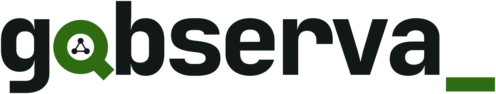

# La marca de Gobserva

**Gobserva** = *Gob*ierno + *observa*. Hace tecnología cívica con los datos del Estado peruano; su primer producto es
Vigía (`vigia.gobserva.cloud`, que firma «Vigía by Gobserva»).

| | |
|---|---|
| Eslogan | **Lo de todos, a la vista de todos.** Lo público es de todos; la lupa lo pone a la vista. |
| Bajada | Tecnología cívica para vigilar el Estado peruano. |
| Cómo trabajamos | Observa. Conecta. Entiende. (leer lo que el Estado publica, cruzarlo, explicarlo con su fuente) |

## El logo



- **Letras:** Space Grotesk Bold, la tipografía de títulos de Vigía (SIL Open Font License 1.1: el archivo y su licencia
  están en `frontend/app/fuentes/`). Los contornos salen de la fuente tal cual, con su kerning; no se redibujan.
- **La «o» es una lupa.** El aro tiene el grosor de las astas de la fuente (118 unidades; las astas van de 112 a 126) y
  la lente es un 8 % más grande que la «o», para que se lea como lupa y quepan los nodos. El mango sale a 45° con un
  corte recto, como los remates de la fuente.
- **Dentro, tres nodos unidos:** una empresa, un contrato y una entidad, lo que Vigía cruza. El vidrio es lima.
- **El isotipo** es la lupa sola: carbón sobre lima. Es el favicon, el ícono del teléfono y el logo que ven los buscadores.

## Colores

| Nombre | Hex | Dónde |
|---|---|---|
| Lima | `#D4FF3F` | El vidrio de la lupa, el fondo del isotipo, los botones principales |
| Carbón | `#0B0F0F` | Los nodos, el fondo oscuro |
| Tinta | `#111817` | Las letras sobre fondo claro |
| Claro | `#E7F0EE` | Las letras sobre fondo oscuro |
| Verde | `#2F6B10` | El acento de los textos sobre fondo claro (el lima no se lee sobre blanco) |

## Archivos (en `../publico/`, servidos en `https://gobserva.cloud/…`)

| Archivo | Para qué |
|---|---|
| `marca/gobserva-logo.svg` y `.png` | Logo sobre fondo claro (PNG de 2000 px, fondo transparente) |
| `marca/gobserva-logo-oscuro.svg` y `.png` | Logo sobre fondo oscuro |
| `marca/gobserva-logo-mono.svg` | A una tinta: sellos, impresión a un color, grabados |
| `marca/gobserva-isotipo.svg` y `.png` | La lupa sola, carbón sobre lima (PNG de 1024 px) |
| `favicon.svg`, `favicon.ico` | La pestaña del navegador (el ICO trae 16, 32 y 48 px dibujados aparte) |
| `apple-touch-icon.png`, `logo.png` | El ícono del teléfono (180 px) y el logo de los datos estructurados (512 px), con aire para las máscaras redondas |
| `og.png` | La imagen al compartir el enlace (1200 x 630) |

La portada usa el logo y la ilustración en línea desde `../marca.js`: toman sus colores del CSS, así siguen al modo día o
noche del visitante.

## Cómo usarlo

- Sobre fondo claro, el logo claro; sobre fondo oscuro, el oscuro. El vidrio siempre lima y los nodos siempre carbón.
- Tamaño mínimo: 24 px de alto para el logo y 16 px para el isotipo. Más chico, los nodos se pierden.
- Aire alrededor: por lo menos el alto de la lupa a cada lado.
- No estirarlo ni girarlo, no cambiar la tipografía, no poner el logo sobre fondo lima (el vidrio se pierde) y no
  cambiar los colores del vidrio o de los nodos.

## Regenerar

```bash
python infrastructure/deploy/cloudflare/gobserva-redirect/marca/generar_marca.py
```

Necesita fontTools, Pillow y Playwright con Chrome (los PNG se dibujan en el navegador). Escribe todo lo de la tabla y
`marca.js`; después, desplegar el Worker (`../README.md`). Las medidas del logo están arriba de `generar_marca.py`.
