# La marca de Gobserva

**Gobserva** = *Gob*ierno + *observa*. Hace tecnología cívica con los datos del Estado peruano; su primer producto es
Vigía (`vigia.gobserva.cloud`, que firma «Vigía by Gobserva»).

| | |
|---|---|
| Eslogan | **Lo de todos, a la vista de todos.** Lo público es de todos; la lupa lo pone a la vista. |
| Bajada | Tecnología cívica para vigilar el Estado peruano. |
| Cómo trabajamos | Observa. Conecta. Entiende. (leer lo que el Estado publica, cruzarlo, explicarlo con su fuente) |

## El logo



`gobserva_`, de la misma familia que `vigía_` (cuarta versión, 2026-11-01: el usuario encontró feo el anterior, de Space
Grotesk con el vidrio lima, y casi no se veía en la página).

- **Letras:** JetBrains Mono ExtraBold (800), la letra con que firma Vigía, con el mismo espaciado (-0.06em). Los
  contornos salen de la fuente tal cual (SIL Open Font License 1.1: el archivo y su licencia están en
  `frontend/app/fuentes/`).
- **La «o» es una lupa.** El aro tiene el grosor de las astas de la fuente (136 unidades; las astas van de 130 a 150) y el
  mango sale a 45° con un corte recto. El vidrio es transparente.
- **Dentro, tres nodos blancos unidos** (una empresa, un contrato y una entidad), como la pupila blanca del ojo de Vigía.
- **El guion bajo** es el cursor de `vigía_`: lima, y en la portada titila (sin movimiento reducido).
- **El isotipo** es la lupa sola: lima con nodos blancos sobre carbón. Es el favicon, el ícono del teléfono y el logo
  que ven los buscadores.

## Colores

| Nombre | Hex | Dónde |
|---|---|---|
| Lima | `#D4FF3F` | La lupa y el cursor sobre fondo oscuro, los botones principales |
| Blanco | `#FFFFFF` | Los nodos sobre fondo oscuro |
| Carbón | `#0B0F0F` | El fondo oscuro y el del isotipo |
| Claro | `#E7F0EE` | Las letras sobre fondo oscuro |
| Tinta | `#111817` | Las letras y los nodos sobre fondo claro |
| Verde | `#2F6B10` | La lupa y el cursor sobre fondo claro (el lima no se lee sobre blanco) |
| Fósforo | `#3DFF8A` | La portada de gobserva.cloud (el radar): la señal, las cifras y los enlaces sobre el negro verdoso `#030B07` |

## Archivos (en `../publico/`, servidos en `https://gobserva.cloud/…`)

| Archivo | Para qué |
|---|---|
| `marca/gobserva-logo.svg` y `.png` | Logo sobre fondo claro (PNG de 2000 px, fondo transparente) |
| `marca/gobserva-logo-oscuro.svg` y `.png` | Logo sobre fondo oscuro |
| `marca/gobserva-logo-mono.svg` | A una tinta: sellos, impresión a un color, grabados |
| `marca/gobserva-isotipo.svg` y `.png` | La lupa sola, lima y blanco sobre carbón (PNG de 1024 px) |
| `favicon.svg`, `favicon.ico` | La pestaña del navegador (el ICO trae 16, 32 y 48 px dibujados aparte) |
| `apple-touch-icon.png`, `logo.png` | El ícono del teléfono (180 px) y el logo de los datos estructurados (512 px), con aire para las máscaras redondas |
| `og.png` | La imagen al compartir el enlace (1200 x 630): el logo, el eslogan en Doto y el mapa de píxeles en la pantalla del radar de la portada (verde fósforo, anillos y barrido) con la lupa sobre Lima. Se rehace sola con `python marca/generar_marca.py --og` |

La portada usa el logo en línea desde `../marca.js`: toma sus colores del CSS, así sigue al modo día o noche del
visitante. El mapa de la portada tiene su propio generador (`../mapa/generar_mapa.py`).

## Cómo usarlo

- Sobre fondo oscuro, el logo oscuro (lupa lima, nodos blancos); sobre fondo claro, el claro (lupa verde, nodos tinta).
- Tamaño mínimo: 24 px de alto para el logo y 16 px para el isotipo. Más chico, los nodos se pierden.
- Aire alrededor: por lo menos el alto de la lupa a cada lado.
- No estirarlo ni girarlo, no cambiar la tipografía, no poner el logo sobre fondo lima (la lupa se pierde) y no
  separar el guion bajo: es parte del nombre, como en `vigía_`.

## Regenerar

```bash
python infrastructure/deploy/cloudflare/gobserva-redirect/marca/generar_marca.py
```

Necesita fontTools, Pillow y Playwright con Chrome (los PNG se dibujan en el navegador). Escribe todo lo de la tabla y
`marca.js`; después, desplegar el Worker (`../README.md`). Las medidas del logo están arriba de `generar_marca.py`.
